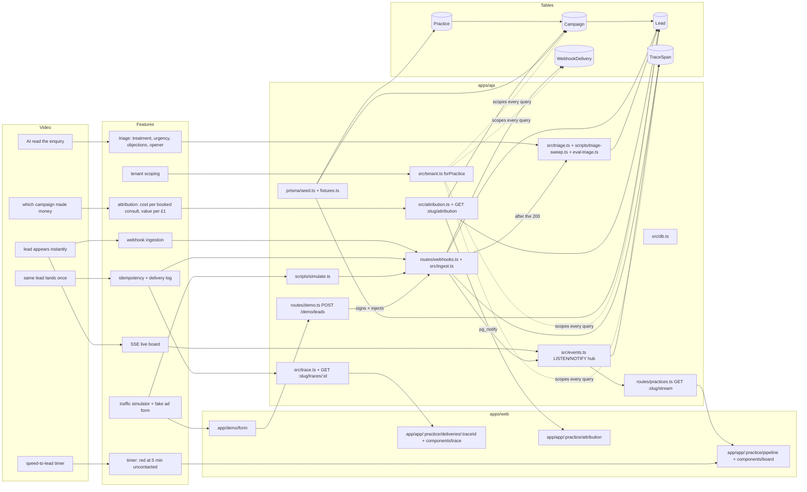

# LeadLine

A lead tracking dashboard for cosmetic dental practices, built as a 2-day demo for a Dentology job application. It ends in a ~2.5 min Loom. Every feature exists because a line in that video needs it. If a feature isn't on camera and won't come up in the interview, don't build it.

Runs locally only. No deploy, no real auth. Three parts:

| Part | Where | Port | Owns |
|---|---|---|---|
| API | `apps/api`: Node 24 + Fastify, run by `tsx` | 4000 | Postgres (Prisma), webhooks, tenancy, LISTEN hub, SSE, traces, triage |
| Web | `apps/web`: Next 16 UI only | 3000 | Rendering. No DB access, no secrets |
| Shared | `packages/shared` | – | zod payloads + DTO types (`LeadCard`, `StreamMessage`, `Trace`); both apps import it |
| DB | `docker-compose.yml`: Postgres 16 | 5433 | `leadline` (demo) and `leadline_test` (tests) |

Env: the root `.env` (`DATABASE_URL`, `GEMINI_API_KEY`) is read by the API, Prisma and the simulator only. `apps/web/.env` has `API_URL`, `NEXT_PUBLIC_API_URL` and `DEFAULT_PRACTICE`. Never give the web app the root `.env`.

Next 16 writes its own agent rules into `apps/web/AGENTS.md` ("this is NOT the Next.js you know"): read `apps/web/node_modules/next/dist/docs/` before writing web code.

To run, test or reset anything, use the `leadline-run` skill.

## Map

Read top to bottom: video beat → feature → code → table. Solid nodes exist; dashed nodes are not built yet. Update the `class` lines when a node lands.

## Decisions and why

- **Idempotency key** is `@@unique([practiceId, source, sourceLeadId])` on `Lead`. Ingestion uses `createManyAndReturn({ skipDuplicates: true })` (`INSERT … ON CONFLICT DO NOTHING RETURNING`); an empty result means duplicate. A duplicate still returns 200 so the platform stops retrying. Never add a "check then insert" path: two concurrent retries would both pass the check.
- **`WebhookDelivery`** logs every request, retries included. It's how the video shows 3 deliveries → 1 lead.
- **SSE, not WebSockets**: data flows one way. One `LISTEN` connection per server process fans out to every open tab, so the tab count never changes the DB connection count.
- **Triage runs after the webhook responds.** A slow or failed model call must never lose a lead. The webhook plugin's `onResponse` hook triages a CREATED lead in-process (`triageLead` in `apps/api/src/triage.ts`), with a continued `RequestTrace` so the Gemini call shows on the webhook's trace. In-flight triage is awaited in `onClose`. Duplicates never trigger it. `buildApp({ classify })` takes the model; tests pass a fake, `server.ts` passes `geminiClassifier()` (null without a key, then leads stay PENDING).
- **Triage outcomes**: 429/408/5xx/network → `TriageBusy` → lead stays `PENDING`, attempts unchanged; a 400 or an off-schema answer → `FAILED`, `triageAttempts + 1`. The write is `updateMany where triageStatus != DONE`, so when the webhook and the sweeper race, the first answer wins and only one `lead.updated` is sent. `bun run triage:sweep` triages PENDING plus FAILED under `--max-attempts` (default 3), newest first, paced (`--every 4`s) with doubling backoff on BUSY. It also backfills the seeded leads.
- **Triage model: Gemini, free API tier, direct call** (`@google/genai` with a response schema, `temperature: 0`, `thinkingLevel: LOW`), behind one function in `apps/api/src/triage.ts`. Model `gemini-3.5-flash-lite` (override with `GEMINI_MODEL`); `gemini-2.5-*` is gone for new keys and `gemini-3.5-flash` returned 503s under load on 2026-10-26. Free-tier latency is ~15-20 s per call. Decided 2026-10-26. Not ADK: triage is a single structured call, and ADK is mainly Python. Free tier means low per-minute limits (expect 429s; triage must back off and leave the lead `PENDING`/`FAILED`, never block it) and Google may use free-tier prompts for training. Fine for synthetic data; for real patient enquiries the answer is the paid tier or Vertex AI. Say this if asked.
- **Seeded leads have `triageStatus = PENDING`** on purpose. Triage fields are only ever written by the real model (a backfill script on day 2). Never fake triage output in the seed.
- **API is a separate Node service** (decided 2026-10-26): webhooks, the LISTEN hub, SSE and post-response triage are long-lived backend work that a serverless Next deploy could kill. Fastify for built-in pino logs with a request id, scoped raw-body parsing and plugin-level hooks.
- **Browser talks to the API directly** (CORS allows only `WEB_ORIGIN`, default `http://localhost:3000`): SSE and drags go straight to :4000, with no proxy that could buffer the stream. Server components call the API server-to-server for first paint.
- **Tracing**: `req.id` is the trace id. A well-formed incoming `x-request-id` is reused, otherwise a UUID is minted, and it's echoed in the response. The webhook collects `TraceSpan`s in memory (`RequestTrace`) and writes them in one insert in `onResponse`, after the 200 is sent. NOTIFY carries `traceId` + `startedAt` for webhook events only (drag/value `lead.updated` events carry neither), so the LISTEN hub (any process) adds its own spans (received, loaded once, pushed to N streams). Every pino line has `reqId`, so `grep <traceId>` the API log for the same request. Bad-signature requests leave log lines only, no rows.
- **Ingest is one transaction**: lead insert + delivery row + `pg_notify` run in `db.$transaction`. NOTIFY fires only at commit, so a crash can't leave a lead whose `lead.created` was never sent (the retry would otherwise be a silent DUPLICATE). `publish(event, tx)` takes the transaction client; never publish with the global client inside a transaction.
- **Resync after a LISTEN drop**: when the hub's LISTEN connection recovers, it sends `ready` down every open stream (`subscribe(practiceId, fn, onResync)`). The browser treats every `ready` after the first as "refetch". Never remove that second meaning of `ready`.
- **Known security gaps (demo, say so if asked)**: no auth on `/practices/*` (anyone who can reach :4000 can read and PATCH by slug; CORS isn't auth); no webhook replay protection (no timestamp/nonce); webhook secrets stored in plaintext. Production: session auth with practice membership, signed timestamps with a 5-minute window, secrets in a secret manager.
- **SSE in Fastify** uses `reply.hijack()` and writes `reply.raw`; CORS headers must be copied from `reply.getHeaders()` into `writeHead` or the browser blocks the stream.
- **Cache Components is on** (Next 16 default here). Layouts and pages are a static shell; every API read sits in an async child under `<Suspense>`. Reading data at the top of a page/layout errors with "uncached data during prerendering".
- **SSE events are resolved server-side once per process** (`resolve()` in `apps/api/src/events.ts`) and handled in NOTIFY order through a promise queue, so parallel queries can't deliver an older `lead.updated` after a newer one.
- **Times render in Europe/London** (`apps/web/src/lib/format.ts`), whatever the viewer's machine says.
- **Lost doesn't stamp `firstContactedAt`**: binning spam unread isn't contact.
- **Fake data never reaches real people**: phones are Ofcom's drama range `07700 900xxx`, emails `@example.com`, names from a curated UK list in `apps/api/prisma/fixtures.ts`.
- **Money is integer pence, GBP.** The script says "per pound spent".
- **Tenancy**: every query goes through `forPractice(practiceId)`. The practice comes from the URL (`/practices/:slug/...` on the API, `/:practice` on the web) and is resolved once in a Fastify `preHandler` that puts `req.db = forPractice(id)` on the request; handlers never see an unscoped client. In production it would come from the session. Unique-where ops (`findUnique`/`update`/`delete`/`upsert`) accept extra non-unique filters since Prisma 5, so the extension adds `practiceId` to `where` without rewriting the op. A cross-tenant `update` by id throws P2025 (not found), the same as a missing row, so it never reveals that the row exists. Raw SQL and nested `include` from `Practice` are **not** scoped: pass `practiceId` explicitly there.
- **Attribution** (`apps/api/src/attribution.ts`): one raw SQL query, `practiceId` passed explicitly (raw SQL isn't scoped by `forPractice`). Counts come from first-reached stage timestamps, so booked-then-lost still counts as booked. Revenue = plan values on accepted leads; `acceptedWithoutValue` flags understated revenue. Ratios are null on a zero divisor. The web page stays dynamic and refetches (debounced) on `lead.*` stream events; no `use cache`, because it changes with every drag.
- **Demo form signing** (decided 2026-10-26 with the user): `POST /demo/leads` (`apps/api/src/routes/demo.ts`, on unless `NODE_ENV=production` or `buildApp({ demo: false })`) signs the form with the clinic's secret and sends it through `/webhooks/leads` with `app.inject`, so it takes the real signature, idempotency, trace and triage path. `deliveries: 3` replays the same signed body, like platform retries. The web app still holds no secret. CORS allows POST for this.
- **Board**: shadcn/ui + drag-and-drop (dnd-kit) between stage columns. The drop is optimistic; the server confirms over SSE.

## Gotchas

- Prisma is pinned to **7.10.1**: npm's `latest` tag points at an 8.0 RC. Don't bump it.
- Prisma 7: the client is generated to `apps/api/src/generated/prisma` (gitignored), imported as `./generated/prisma/client`, and needs the `PrismaPg` adapter. `migrate dev` doesn't run `generate`; the API's `postinstall` does, or run `bunx prisma generate` in `apps/api`.
- Config is `apps/api/prisma.config.ts`; it loads the **root** `.env`. There's no `url` in `schema.prisma`.
- Schema changes: hand-write the migration, or generate it with `bunx prisma migrate diff --from-config-datasource --to-schema prisma/schema.prisma --script > .../migration.sql` and **delete the `Loaded Prisma config` banner line it writes into the file**. Apply with `migrate deploy` to both `leadline` and `leadline_test` (`DATABASE_URL=...leadline_test bunx prisma migrate deploy`). `migrate dev` is interactive and fails here.
- `tsx watch` and `next dev` both hot-reload, but a module rewritten while running can leave a stale export ("x is not a function"). Restart `bun run dev`.
- Workspace TypeScript: `@leadline/shared` exports `.ts` source. The web app compiles it via `transpilePackages`; the API runs it through `tsx`. There's no build step for shared.
- `.claude/skills/prisma-*` are Prisma's official skills, vendored as real folders (not symlinks).

## Progress

- 2026-10-26 Day 1 step 1 done: Bun + Next 16.4, Postgres in Docker, schema + `init` migration, deterministic seed (2 practices, 6 campaigns, 95 leads).
- 2026-10-26 Step 2 done (pre-split paths; now `apps/api/src/tenant.ts`): `forPractice`; `tests/tenancy.test.ts` 7/7 against the `leadline_test` DB (setup uses `migrate deploy`; Prisma 7 refuses `migrate reset` from an AI agent without user consent).
- 2026-10-26 Step 3 done (pre-split path; now `POST /webhooks/leads` on the API): HMAC-signed webhook (one normalised zod payload; unknown UTM auto-creates a £0 campaign; first write wins; bad signature → 401 and no row; signed-but-invalid → 400 + REJECTED row). `tests/ingest.test.ts` covers 3 concurrent retries → 1 lead + 3 deliveries. 13/13 tests. Verified live with curl.
- Schema changes are hand-written migrations applied with `migrate deploy` (`migrate dev` is interactive), then `prisma migrate diff --from-config-datasource --to-schema prisma/schema.prisma --script` must print an empty migration.
- 2026-10-26 Step 4 done: `bun run simulate` (`--one`, `--burst-dupes`, `--count/--every/--dupe-rate`, `--practice`).
- 2026-10-26 Step 5 done: live board at `/<practice>`: SSE, drag-and-drop (dnd-kit, `DndContext id` from `useId` to avoid a hydration mismatch), speed timer, lead drawer with treatment value, live delivery log. Verified headless (Playwright + local Chrome): burst lead appears live, drawer opens, drag persists with first-contact stamp, no console errors.
- 2026-10-26 Split into services: Bun workspaces (`apps/api` Fastify, `apps/web` Next, `packages/shared`). Server actions and Next route handlers are gone; the web calls the API. Added end-to-end tracing (`TraceSpan`, migration `20261026140000_trace_spans`, trace sheet on delivery-log rows). 15/15 tests; headless E2E: live lead, trace waterfall, drag → API PATCH, no console errors. Day-1 single-app snapshot was saved before the split (scratchpad, not in repo).
- 2026-10-26 Three agents: (1) tests 15 → 79 + coverage (~98% lines) + `postman/` collection (22 requests, newman green) + `docs/testing.md` (45 decisions → tests); two SSE bugs fixed (listener leak when a tab closes mid-subscribe; no `x-request-id` on SSE). (2) `docs/01..05` with 12 mermaid diagrams + the UI/UX audit. (3) impeccable redesign of `apps/web` done: "registered post" visual world (see `apps/web/DESIGN.md`, `PRODUCT.md`); landing `/`; `/app` → `/app/[practice]/{pipeline,deliveries,deliveries/[traceId],attribution (Coming)}`; one SSE provider with a real status pill; keyboard "Move to" menu; grouped deliveries; deep-linkable trace page; error/not-found states showing the request id; practice list cached with `use cache` + `cacheTag('practices')`, everything live stays dynamic. E2E script: scratchpad `shots/e2e.ts`.
- 2026-10-26 Fixed from the agents' findings: transactional ingest, hub resync on LISTEN reconnect, 4xx logged at WARN, half-penny rounding. 82 tests (`tests/reliability.test.ts`).
- 2026-10-26 Day 1 pushed to GitHub (`priyanshu14077/Leadline`): `master` = README only, PR #1 (`feat/leadline-services`, 76 commits) merged by the user.
- 2026-10-26 Day 2 on `feat/day2-triage-attribution-form`: Gemini triage (webhook `onResponse` + `triage:sweep` + `triage:eval` over 20 labelled cases in `scripts/eval-set.ts`), migration `20261027090000_triage_attempts`, attribution API + page, `POST /demo/leads` + `/demo/form`. Landing "Coming next" section removed. 104 API tests. First eval (gemini-3.5-flash-lite, 2026-10-26): treatment 20/20, urgency 17/20 (all three misses rated a browsing enquiry MEDIUM, not LOW), objections 18/20 exact-set, 0 errors, median 21 s with heavy 429 backoff. The prompt was not tuned to the eval set: 20 items would overfit. Headless E2E (scratchpad `shots/day2.ts`): form → 3 deliveries → 1 lead → card live → triage chip live (~19 s) → opener in drawer → Gemini span on the trace → attribution +1 live; no console errors.
