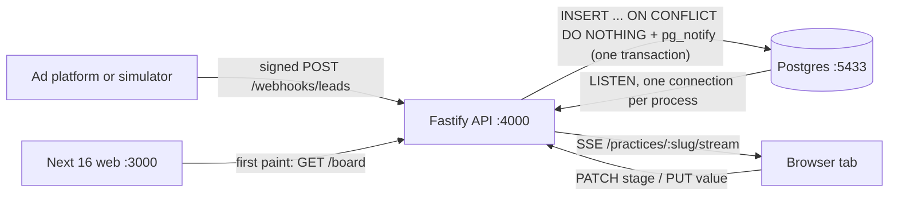

# LeadLine

A live lead board for cosmetic dental clinics.

Ad platforms (Meta Lead Ads, Google lead forms) post each enquiry to a signed webhook. LeadLine stores it once, even when the platform retries, and pushes it to every open browser tab straight away. A speed-to-lead timer shows how long each patient has waited for a call and turns red at 5 minutes. The team drags leads from New to Contacted, Consult booked and Treatment accepted, and records the value of the treatment plan. Every webhook request is logged and can be traced step by step.

It's a two-day demo built for a Dentology job application. It runs locally only.

## Status

| Built | Planned, not built yet |
|---|---|
| Signed webhook ingestion (HMAC-SHA256) | AI triage of each enquiry with Gemini |
| Idempotent ingest: 3 retries → 1 lead + 3 logged deliveries | Campaign attribution (cost per booked consult, value per £1) |
| Live board over SSE, fed by Postgres LISTEN/NOTIFY | Fake Meta ad form at `/demo/form` |
| Drag-and-drop and keyboard stage moves | |
| Speed-to-lead timer | |
| Delivery log and per-request trace view | |
| Per-clinic data scoping (multi-tenant) | |
| Traffic simulator | |

## Architecture



| Part | Path | Stack |
|---|---|---|
| API | `apps/api` | Node 24, Fastify 5, Prisma 7 (`PrismaPg` adapter), pino |
| Web | `apps/web` | Next 16 (Cache Components), React 19, Tailwind 4, shadcn/ui, dnd-kit |
| Shared | `packages/shared` | zod payloads and DTO types used by both apps |
| Database | `docker-compose.yml` | Postgres 16 |

The web app has no database access and holds no secrets. The browser talks to the API directly for the SSE stream and stage moves.

## Run it

You need [Bun](https://bun.sh) 1.4+, Node 24 and Docker.

```bash
bun install
cp .env.example .env                    # add GEMINI_API_KEY when triage lands
cp apps/web/.env.example apps/web/.env
bun run db:up                           # Postgres 16 on localhost:5433
bun run db:migrate
bun run db:seed                         # 2 clinics, 6 campaigns, 95 leads
bun run dev                             # API on :4000, web on :3000
```

Open http://localhost:3000, then send traffic from another terminal:

```bash
bun run simulate --one               # one new lead
bun run simulate --burst-dupes       # one lead delivered 3 times → 1 card, 3 deliveries
bun run simulate                    # steady stream with occasional retries
```

## Scripts

| Command | What it does |
|---|---|
| `bun run dev` | Start the API and the web app |
| `bun run test` | API tests (Vitest, against the `leadline_test` database) |
| `bun run typecheck` | Type-check every workspace |
| `bun run lint` | Lint the web app |
| `bun run demo:reset` | Reset the demo database and seed it again |
| `bun run db:studio` | Open Prisma Studio |

The Postman collection in `postman/` covers every endpoint, including signed webhooks.

## Docs

Start at [`docs/README.md`](docs/README.md): the problem, the architecture (with mermaid diagrams), the design decisions, the ad-platform integrations, the UI audit and the testing strategy.

## Known gaps

This is a local demo. There's no auth on `/practices/*`, no webhook replay protection and webhook secrets are stored in plaintext. In production: session auth with practice membership, signed timestamps with a 5-minute window, and secrets in a secret manager.

Demo data is synthetic. Phone numbers use Ofcom's drama range (`07700 900xxx`) and emails use `@example.com`.
