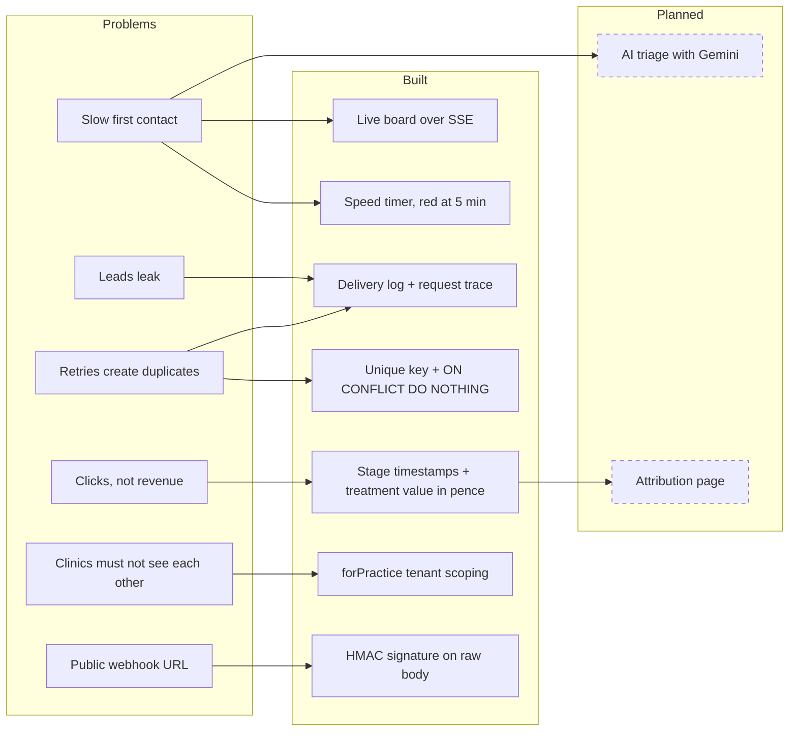

# 1. The problem

## In business terms

Dentology runs paid ads (Meta, Google, TikTok), content and an in-house sales team for high-end cosmetic dental clinics in the UK. Each clinic pays for patients, not clicks. A patient who books a consult and accepts an implant or veneer plan may be worth £3,000–£25,000. A lead that nobody rings is money already spent on ads that returns nothing.

Between the ad and the booked consult, leads are lost in four ways:

1. **Slow first contact.** Someone fills in an Invisalign lead form at 20:41 while scrolling Instagram. If nobody calls for two hours, they have forgotten, filled in a competitor's form, or stopped picking up. The first minutes are the most valuable, so the agency's sales team measures speed-to-lead.
2. **Leakage.** Leads arrive in a Meta inbox, a Google Ads CSV, the website form and email notifications. Some are never copied into whatever the team works from. Nobody notices the missing lead, because nothing records that it existed.
3. **Duplicates.** Ad platforms retry webhooks when they don't get a fast 200. The same patient can arrive two or three times. If two closers both ring them, it looks unprofessional. If the clinic counts three leads, cost per lead looks better than it is.
4. **Wrong success metric.** Platforms report clicks, cost per lead and form fills. A £199 TikTok whitening offer can produce the most leads and almost no bookings. The figures that matter to the clinic are cost per **booked consult** and treatment value per **£1 of ad spend**.

## Who uses it

| User | What they need | What they do in LeadLine |
|---|---|---|
| **The agency's in-house sales team** (closers/setters) | Know who to ring right now and what the patient asked for. Never ring the same person twice. | Watch the board, open a lead, ring them, drag the card to Contacted, then Consult booked. Enter the plan value when treatment is accepted. |
| **Clinic owner / founder** (often the principal dentist) | Proof that the leads they pay for are worked fast, and which campaigns make money. | Looks at the board, the speed timers and (planned) attribution. They are not technical. |
| **The agency's marketers** (media buyers) | Which campaign and creative produces booked consults, not cheap form fills, so they can move budget. | Planned: the attribution page. Today they can see the campaign on each card. |
| **The agency's ops / engineer** | Proof that every webhook arrived and was stored once. A way to debug a missing lead. | The delivery log and the request trace. |

## One agency, many clinics

The agency runs the same pipeline for many competing clinics. Smile Studio London must never see Harley Dental Manchester's patients, campaigns or spend. That is a commercial line and a legal one: patient enquiries about treatment are personal data, and arguably health data under UK GDPR (see [04-integrations.md](04-integrations.md#pii-and-uk-gdpr)). A single missed `WHERE practiceId = ...` leaks one clinic's patients to another.

## The technical problems underneath

| Business problem | Technical shape |
|---|---|
| Speed-to-lead | The lead must reach the screen in sub-second time, without anyone refreshing. The timer must count from when the lead *arrived*, not when someone looked. |
| Leakage | Every inbound request must be recorded, including rejects and retries, so "did we get it?" has an answer. |
| Duplicates | Webhooks are delivered **at least once**. Concurrent retries can arrive within milliseconds of each other. Exactly one lead must be created, and every retry must get a 200 so the platform stops retrying. |
| Untrusted senders | The webhook URL is public. Anyone could POST fake leads, so requests must be authenticated without writing anything for a stranger. |
| Attribution | Each lead must keep its campaign (`utm_campaign`), and stage changes must be timestamped, so cost per booked consult can be computed later. Money must be exact. |
| Multi-tenant | Scope every query to one clinic by construction, not by remembering. |
| Live for many tabs | A sales floor may have 10 tabs open. That must not mean 10 database connections. |

## Feature → problem map

| Feature | Status | Problem it answers | Code |
|---|---|---|---|
| Signed webhook ingestion | Built | Public URL; leakage | `apps/api/src/routes/webhooks.ts:31-79`, `apps/api/src/signature.ts:11-17` |
| Idempotency on `(practiceId, source, sourceLeadId)` | Built | Duplicates from retries | `apps/api/prisma/schema.prisma:62`, `apps/api/src/ingest.ts:40-62` |
| Delivery log (every request, retries included) | Built | Leakage, duplicate visibility | `apps/api/src/ingest.ts:76-81`, `apps/web/src/components/board/delivery-log.tsx:16-57` |
| Request trace waterfall | Built | "Where did this lead go?" debugging | `apps/api/src/trace.ts:9-46`, `apps/web/src/components/board/trace-sheet.tsx:19-88` |
| Live board (SSE + LISTEN/NOTIFY) | Built | Speed-to-lead: no refresh needed | `apps/api/src/events.ts:55-115`, `apps/web/src/hooks/use-lead-stream.ts:11-31` |
| Speed timer: green < 3 min, amber < 5, red after | Built | Speed-to-lead made visible | `apps/web/src/components/board/speed-timer.tsx:8-59` |
| "N over 5 minutes" counter | Built | Speed-to-lead at team level | `apps/web/src/components/board/board.tsx:193-212` |
| Drag stages, first-reach timestamps | Built | Funnel data for attribution; honest speed-to-lead | `apps/api/src/leads.ts:73-84` |
| Treatment plan value in pence | Built | Value per £1 later | `apps/api/src/routes/practices.ts:86-96` |
| Tenant scoping | Built | Clinics never see each other | `apps/api/src/tenant.ts:50-64` |
| Traffic simulator (Meta/Google-style retries) | Built | Demo and load | `apps/api/scripts/simulate.ts:59-67` |
| AI triage (treatment, urgency, objections, opener) | **Planned** | Closers know what to say before ringing | not built; `@google/genai` is installed (`apps/api/package.json:20`) but no `src/triage.ts` exists |
| Attribution: cost per booked consult, value per £1 | **Planned** | Clicks vs revenue | not built; the nav links to it and it 404s (`apps/web/src/components/practice-nav.tsx:14`) |
| Fake Meta ad form `/demo/form` | **Planned** | Demo: a person fills a form, the card appears | not built |
| 20-item triage eval | **Planned** | Trust in the model | not built |

## What the seed data is designed to show

`apps/api/prisma/fixtures.ts:74` gives the "£199 whitening – TikTok" campaign a 6% book rate against 30–42% for the others. On the planned attribution page it should have the most leads and almost no bookings. That is the "clicks aren't revenue" story in one row.
