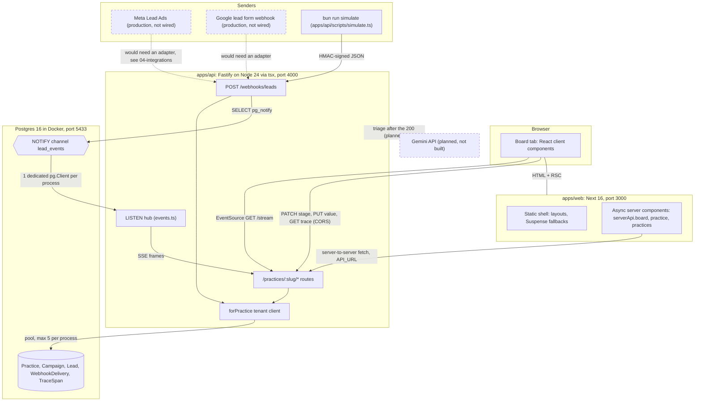
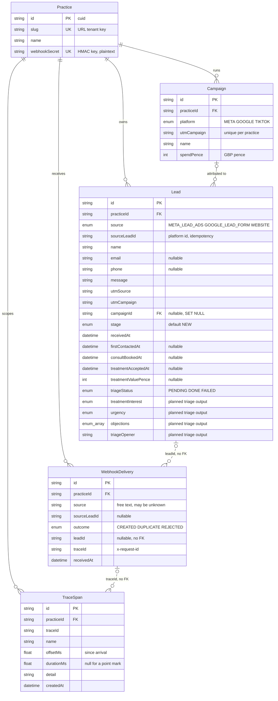
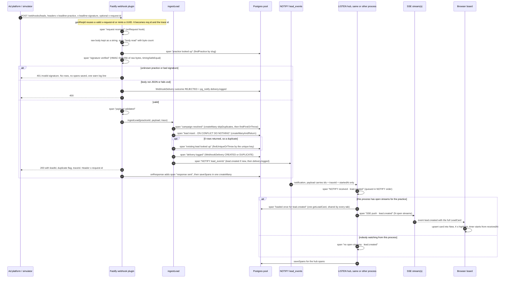
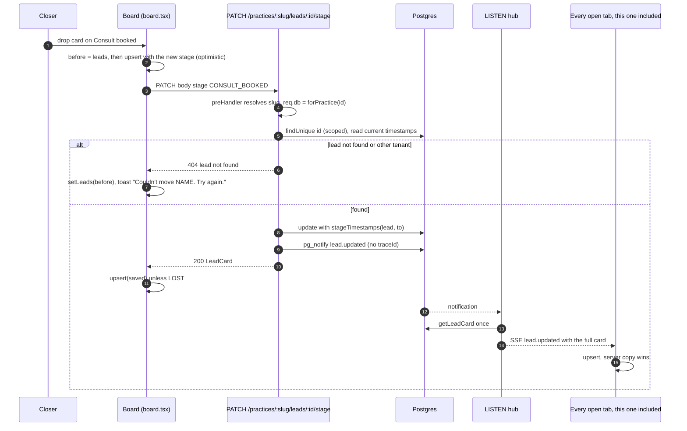
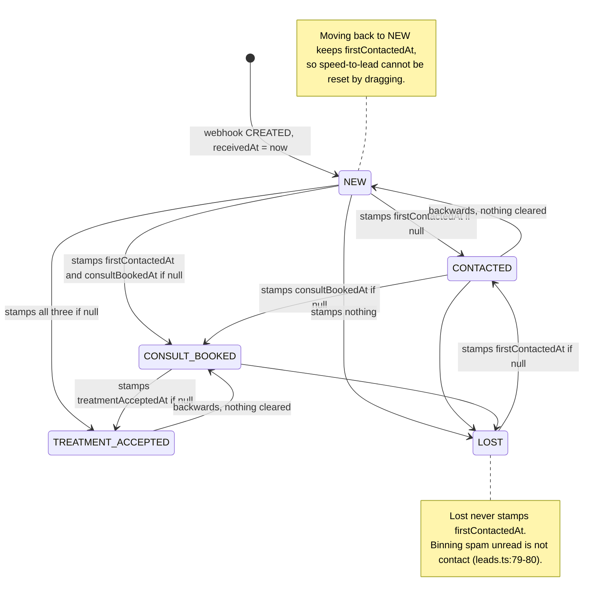
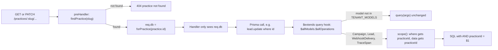
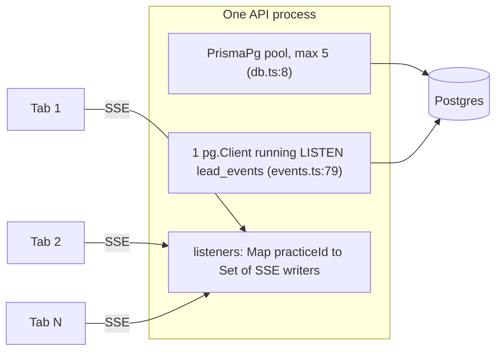
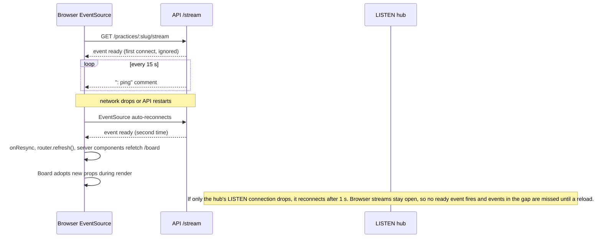

# 2. Architecture

## 2.1 Services

| Part | Runs | Owns | Never does |
|---|---|---|---|
| `apps/api` | `tsx watch` on `src/server.ts` (`apps/api/package.json` `dev` script), Fastify built in `apps/api/src/app.ts:10-43` | Postgres, webhooks, tenancy, the LISTEN hub, SSE, traces | Render HTML |
| `apps/web` | `next dev`, Cache Components on (`apps/web/next.config.ts:5`) | Rendering only. Server components fetch the API (`apps/web/src/lib/api.ts:31-35`). The browser calls the API directly (`apps/web/src/lib/api.ts:38-45`) | Touch the DB, hold secrets. It only has `API_URL`, `NEXT_PUBLIC_API_URL`, `DEFAULT_PRACTICE` (`apps/web/.env`) |
| `packages/shared` | Imported as TypeScript source by both | zod payloads and DTO types: `leadPayload`, `LeadCard`, `StreamMessage`, `Trace` (`packages/shared/src/index.ts:25-95`) | Contain logic |
| Postgres | `docker-compose.yml`, port 5433 | Data, uniqueness, NOTIFY | – |

The shared package is the contract. The API's Prisma rows must be assignable to the shared types (`packages/shared/src/index.ts:1-2`). So a schema change that breaks the UI fails typecheck in the API, not at runtime.

## 2.2 Data model (5 tables)

Constraints and indexes that carry the design (`apps/api/prisma/schema.prisma`):

| Constraint | Line | Why |
|---|---|---|
| `Lead @@unique([practiceId, source, sourceLeadId])` | `:62` | The idempotency key. The database decides "already have it", not app code. |
| `Lead @@index([practiceId, stage, receivedAt])` | `:63` | The board query filters by practice and stage and sorts by `receivedAt` (`apps/api/src/leads.ts:45-62`). |
| `Campaign @@unique([practiceId, utmCampaign])` | `:32` | Lets `ensureCampaign` race safely with `skipDuplicates` (`apps/api/src/ingest.ts:20-24`). |
| `Practice.webhookSecret @unique` | `:15` | Rename of the old `webhookKey` (`apps/api/prisma/migrations/20261026120000_webhook_secret/migration.sql:2-3`). |
| `WebhookDelivery @@index([traceId])`, `TraceSpan @@index([practiceId, traceId])` | `:81`, `:98` | Trace lookups. |
| `onDelete: Cascade` from Practice; `SetNull` from Campaign to Lead | `:25`, `:38`, `:49` | Deleting a clinic deletes its data. Deleting a campaign keeps its leads. |

Not enforced: `WebhookDelivery.leadId` has no foreign key (`apps/api/prisma/schema.prisma:75`), and `TraceSpan.traceId` is a loose string. Both are logs: they must accept a write even when the related row is odd or missing.

Migrations: `20261026060938_init` (tables, enums, unique keys), `20261026120000_webhook_secret` (rename API key to HMAC secret), `20261026140000_trace_spans` (adds `WebhookDelivery.traceId` and the `TraceSpan` table).

## 2.3 One webhook, POST to card-on-screen

Span names are the exact strings recorded by `apps/api/src/routes/webhooks.ts`, `apps/api/src/ingest.ts` and `apps/api/src/events.ts`. Timings come from a real trace captured during the audit (screenshot: `/private/tmp/claude-501/-Users-priyanshukumar-Documents-projects-dentology/91dc98e2-a37a-4500-a285-ef9cfdbbaaeb/scratchpad/shots/audit/09-trace.png`).

Points to know when explaining it:

- **The 200 does not wait for tracing.** Spans are collected in memory (`apps/api/src/trace.ts:9-29`) and written in `onResponse` after the reply is sent (`apps/api/src/routes/webhooks.ts:26-29`).
- **NOTIFY happens before the 200.** `publish` is awaited inside `ingestLead` (`apps/api/src/ingest.ts:84-91`). The hub can receive the event before the response is on the wire. The real trace shows "NOTIFY received · lead.created" at 14 ms and "response sent" at 14 ms.
- **Each process writes its own spans.** The hub places its spans on the request's timeline with `Date.now() - startedAt` (`apps/api/src/events.ts:58`). `startedAt` travels in the NOTIFY payload (`apps/api/src/ingest.ts:83`). Within the request, offsets come from `performance.now()` (`apps/api/src/trace.ts:13`). Across processes they come from wall-clock time, so cross-host clock skew would show up in the waterfall.
- **One transaction (fixed 2026-10-26).** Lead insert, delivery insert and both `pg_notify` calls run in one `$transaction` (`apps/api/src/ingest.ts`). Postgres delivers a NOTIFY only at commit, so a board never hears about a lead that isn't there. A crash mid-way leaves nothing behind, so the platform's retry is a fresh `CREATED` whose event does go out. Proven by `tests/reliability.test.ts › a failure after the insert rolls back the lead, the delivery and the NOTIFY together`. Cost: each ingest holds a pool connection for the length of the transaction (a few ms). See ADR-03 in [03-decisions.md](03-decisions.md).
- **A duplicate sends only `delivery.logged`** (`apps/api/src/ingest.ts:87-88`). The board gets a new "Duplicate" row and no card change.

## 2.4 A drag: optimistic update, PATCH, NOTIFY, SSE confirm

Code: optimistic move and rollback `apps/web/src/components/board/board.tsx:104-124`; handler `apps/api/src/routes/practices.ts:72-84`.

The same card comes back twice, once in the PATCH response and once over SSE. `upsert` replaces by id (`apps/web/src/components/board/board.tsx:73-82`), so applying it twice is harmless. Rollback restores the whole `before` array (`board.tsx:110`, `:116`). Any SSE update that arrived during the request is overwritten until the next event or resync. That is a known edge.

Moving to **Lost** removes the card from the board and bumps the "lost" counter once per id (`board.tsx:54-56`, `:74-77`). The drop target only appears while dragging (`board.tsx:177-191`).

## 2.5 Lead stages and timestamp rules

`stageTimestamps` (`apps/api/src/leads.ts:73-84`) allows any move, including backwards. Each timestamp records the **first** time a stage was reached and is never cleared.

The full rule set:

| Target stage | `firstContactedAt` | `consultBookedAt` | `treatmentAcceptedAt` |
|---|---|---|---|
| `NEW` | unchanged | unchanged | unchanged |
| `CONTACTED` | set if null | unchanged | unchanged |
| `CONSULT_BOOKED` | set if null | set if null | unchanged |
| `TREATMENT_ACCEPTED` | set if null | set if null | set if null |
| `LOST` | unchanged | unchanged | unchanged |

Board visibility (`apps/api/src/leads.ts:42-62`): every `NEW` and `CONTACTED` lead, plus `CONSULT_BOOKED` and `TREATMENT_ACCEPTED` leads reached in the last 7 days. `LOST` leads only appear as a count.

The speed timer (`apps/web/src/components/board/speed-timer.tsx:12-59`): once `firstContactedAt` is set, it freezes at the time to first contact (green under 5 minutes). Otherwise it ticks: green under 3 min, amber under 5, red with a pulse after 5. A `LOST` lead with no contact shows "Not contacted". One shared 1-second ticker drives every timer (`apps/web/src/hooks/use-now.ts:5-28`). The server snapshot is `null`, so no time is baked into server HTML (`use-now.ts:26-27`).

## 2.6 Tenancy

How it works (`apps/api/src/tenant.ts`):

- `forPractice(practiceId)` returns `prisma.$extends(...)` with a query hook on every model and operation (`:50-64`). Only the four tenant models are touched (`:5`). `Practice` is the tenant itself.
- For read, update and delete operations (`:7-21`) plus `upsert`, it **spreads** `practiceId` into `where`: `{ ...args.where, practiceId }` (`:30-33`). It doesn't wrap in `AND`.
- **Why unique-where ops still work.** Since Prisma 5, `findUnique`, `update`, `delete` and `upsert` accept extra non-unique filters next to the unique field. So `where: { id, practiceId }` is still a valid unique-where. A cross-tenant `update` by id finds no row and throws P2025, the same error as a missing row. It never reveals that the row exists in another clinic.
- For creates (`:34-38`), it stamps `practiceId` onto `data`, including each row of `createMany`/`createManyAndReturn`.
- For updates (`:43-45`), it forces `data.practiceId` to the current tenant, so a row can never be moved to another clinic.
- The practice comes from the URL and is resolved once in a Fastify `preHandler` (`apps/api/src/routes/practices.ts:31-37`). Handlers never receive an unscoped client. In production it would come from the session (`practices.ts:23-27`).
- The webhook resolves the practice from `x-leadline-practice` and HMAC instead (`apps/api/src/routes/webhooks.ts:36-46`), then `ingestLead` builds its own scoped client (`apps/api/src/ingest.ts:33`).

**What is NOT scoped:**

| Path | Why it escapes | What the code does instead |
|---|---|---|
| Raw SQL (`$queryRaw`, `$executeRaw`) | Query extensions only see model operations | `publish` uses the base client for `pg_notify` (`apps/api/src/events.ts:24`); it carries no tenant data. Any future raw SQL must pass `practiceId` explicitly |
| Nested reads from `Practice`, e.g. `practice.findUnique({ include: { leads: true } })` | The hook sees the operation on the parent model (`Practice`, not a tenant model). The nested relation query is not rewritten | No code does this. `leadCardSelect` includes `campaign` (`apps/api/src/leads.ts:14`), which is safe because the lead was already scoped and owns that campaign |
| The base `prisma` client | It is a plain import | Used only for `findPractice`/`listPractices` (`apps/api/src/practice.ts:3-9`) and `saveSpans`, which sets `practiceId` explicitly (`apps/api/src/trace.ts:43-46`) |
| Nested writes (`create: { campaign: { create: ... } }`) | The hook stamps only the top-level `data` | No code does nested writes |

Tests: `apps/api/tests/tenancy.test.ts` (see [testing.md](testing.md)).

## 2.7 Connection budget

- **Per API process: at most 6 Postgres connections.** That's the Prisma pool's 5 (`apps/api/src/db.ts:5-9`) plus 1 dedicated LISTEN client (`apps/api/src/events.ts:77-105`). It doesn't matter how many tabs are open.
- A tab costs one HTTP connection to the API and one entry in an in-memory `Set` (`apps/api/src/events.ts:107-115`), not a DB connection.
- Each NOTIFY costs **one** query per process, no matter how many tabs watch. `resolve()` runs once and the message is written to every listener (`apps/api/src/events.ts:63-70`). The trace shows it: "loaded once for lead.created … 1 query, shared by every tab".
- If a process has no open streams for the practice, it skips the query (`apps/api/src/events.ts:64-65`).
- Both the client and the hub live on `globalThis`, so `tsx watch` reloads and test workers don't open new pools (`apps/api/src/db.ts:13-18`, `apps/api/src/events.ts:33-38`).
- Scaling formula: `instances × (5 + 1)` must stay under Postgres `max_connections` minus headroom. 10 instances = 60. Behind a transaction-mode pooler (PgBouncer, Supavisor), LISTEN needs a **session** connection, because LISTEN state lives on one backend.
- The browser side has a limit too: HTTP/1.1 browsers allow about 6 connections per origin. Each tab's EventSource uses one. Many tabs of the same origin on HTTP/1.1 can starve other requests. HTTP/2 in production removes this.

## 2.8 Reconnects and resync

Code: `ready` written on every connect (`apps/api/src/routes/practices.ts:62-63`), heartbeat (`:61`), client resync (`apps/web/src/hooks/use-lead-stream.ts:22-25`), adopting refreshed props (`apps/web/src/components/board/board.tsx:63-70`), hub reconnect (`apps/api/src/events.ts:80-89`).

## 2.9 Error handling and logging

- Zod errors anywhere become `400 { error: "invalid body", issues }` (`apps/api/src/app.ts:26-27`). Other errors keep their status. 5xx messages are replaced with "internal error" (`app.ts:28-29`).
- Every response carries `x-request-id` (`apps/api/src/app.ts:22-24`), and CORS exposes it (`app.ts:36`). The web client puts it on `ApiError` (`apps/web/src/lib/api.ts:23-26`).
- Logs are pino: pretty in dev, JSON in production for log-based metrics (`apps/api/src/server.ts:5-14`). Every line carries `reqId`.
- Graceful shutdown closes Fastify, the hub and Prisma on SIGINT/SIGTERM (`apps/api/src/server.ts:19-26`).
