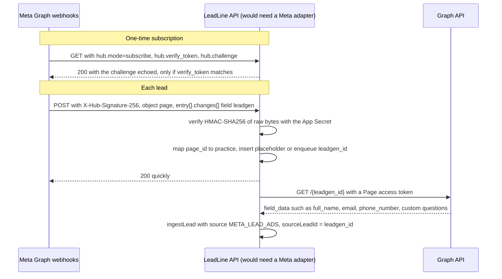

# 4. Webhook integrations

LeadLine has **one** inbound format today: its own normalised JSON (`packages/shared/src/index.ts:25-39`), signed with `x-leadline-signature` and routed with `x-leadline-practice`. The simulator sends this format (`apps/api/scripts/simulate.ts:42-57`). Real Meta and Google webhooks don't, so each needs an adapter that verifies the platform's own signature, maps the payload, and then calls `ingestLead`.

Sources were checked on 2026-10-26. Links are at the end of each section.

## Summary

| Concern | Implemented | Not implemented (what production needs) |
|---|---|---|
| Authentication | HMAC-SHA256 over raw bytes, `sha256=` hex, timing-safe compare, per-practice secret (`apps/api/src/signature.ts:6-17`) | Meta: verify `X-Hub-Signature-256` with the **App Secret** (one per app, not per clinic). Google: compare `google_key` in the body |
| Tenant routing | `x-leadline-practice` header (`apps/api/src/routes/webhooks.ts:62`) | Map Meta `page_id` or Google `form_id`/`campaign_id` to a practice in a lookup table |
| Subscription handshake | None | Meta `GET` with `hub.mode`/`hub.verify_token`/`hub.challenge` |
| Lead data | Full lead in the body | Meta sends only `leadgen_id`: fetch the lead from the Graph API with a Page token |
| Idempotency | Unique `(practiceId, source, sourceLeadId)` + ON CONFLICT (`apps/api/prisma/schema.prisma:64`) | Use Meta `leadgen_id` / Google `lead_id` as `sourceLeadId`. Handle Meta batches of many changes |
| Fast response | 200 within ~15 ms locally. Tracing is written after the response | Meta: ack the ping first and fetch the Graph API lead in a background job |
| Out-of-order arrival | Not relevant: leads are created once and never updated by webhooks | Needed if platforms ever send updates: compare `created_time`/`updated_time` |
| Replay protection | **None** | Signed timestamp + tolerance window, or a nonce store |
| Body size | Fastify default 1 MiB, so 413 above it. Verified locally | Set an explicit `bodyLimit` (e.g. 256 KB) on the webhook plugin |
| Test events | – | Google `is_test: true`: log it, don't create a real lead |
| PII / UK GDPR | Synthetic data only (ADR-16) | Lawful basis + Article 9 condition, DPA with processors, retention, encryption, access logging |
| AI on patient text | Built on the Gemini **free** tier, after the 200, synthetic data only (ADR-15, `apps/api/src/triage.ts`). Sends the first name and message only | Paid Gemini tier or Vertex AI with a DPA. Never the free tier for real enquiries |

## Meta Lead Ads

### How it works

- **Verification handshake (not implemented).** On subscribe, Meta sends a `GET` with `hub.mode=subscribe`, `hub.verify_token` (the string you typed in the App Dashboard) and `hub.challenge`. Check the token, then reply with the challenge. LeadLine has no `GET /webhooks/leads` and returns 404 today (verified).
- **Signature (not implemented for Meta).** Meta signs each POST with SHA-256 and sends `X-Hub-Signature-256: sha256=<hex>`, keyed with the **App Secret**. LeadLine's scheme is the same shape (`apps/api/src/signature.ts:6`), but uses a per-practice secret and its own header. A Meta adapter would verify with the one App Secret and then map `page_id` to a practice. Meta's docs note that validation is "recommended but optional". Do it anyway.
- **Never re-serialise before verifying.** Meta computes the signature over an escaped-unicode form of the payload with lowercase hex digits (Messenger webhooks docs). `JSON.parse` followed by `JSON.stringify` turns `é` into `é` and drops whitespace. The bytes change, so the HMAC fails. LeadLine keeps the body as the received string and verifies before parsing (`apps/api/src/routes/webhooks.ts:15-18`, `:33-39`, `:50`). Any adapter must keep that order.
- **The payload has no lead data.** `entry[].changes[].value` carries `leadgen_id`, `page_id`, `form_id`, `adgroup_id`, `ad_id`, `created_time`. No name, phone or message. You fetch the lead with `GET /{leadgen_id}`.
- **Permissions and tokens.** Reading leads needs `leads_retrieval`. Full lead data also needs `ads_management`, `pages_show_list`, `pages_read_engagement`, `pages_manage_ads`. Subscribing needs `pages_manage_metadata`. Meta recommends a long-lived **Page access token**. The token must belong to someone with the ADVERTISE task on the Page. The Leads Access Manager can restrict which people or CRMs may read leads once a business admin customises it. Each clinic's Page needs its own token, stored encrypted per practice. That's a new table: `Practice` has nothing for it today.
- **Latency.** Meta says real-time pings can arrive "with a delay of up to a few minutes". Speed-to-lead should count from Meta's `created_time`, not LeadLine's `receivedAt`, once the adapter exists. Today `receivedAt` is the DB default `now()` (`apps/api/prisma/schema.prisma:51`).
- **The 90-day retrieval window** often quoted in third-party guides could not be confirmed on a Meta primary page. Treat it as unverified and fetch immediately anyway.

### Delivery semantics

- **Retries:** Meta retries a failed delivery immediately, then "a few more times with decreasing frequency over the next 36 hours", then drops it.
- **Batching:** one POST can carry up to 1000 updates, and batching is not guaranteed. An adapter must loop over every `entry[]` and `changes[]`, and ingest each one idempotently. One bad change must not fail the whole batch, or Meta retries all of them.
- **Duplicates:** "Your server should handle deduplication." That's the unique constraint (ADR-03).
- **Response:** "respond to all Event Notifications with 200 OK". No time limit is stated, so respond quickly. That means the Graph API fetch must not sit on the request path: a slow Graph call would make Meta time out and retry.

Sources: [Webhooks getting started](https://developers.facebook.com/docs/graph-api/webhooks/getting-started) · [Webhooks for leadgen](https://developers.facebook.com/docs/graph-api/webhooks/getting-started/webhooks-for-leadgen) · [Retrieving leads](https://developers.facebook.com/docs/marketing-api/guides/lead-ads/retrieving) · [Messenger webhooks, signature note](https://developers.facebook.com/docs/messenger-platform/webhooks)

## Google Ads lead form webhooks

- **Full lead data in the POST.** Fields: `lead_id`, `api_version`, `form_id`, `campaign_id`, `google_key`, `user_column_data[]` (each `column_id` + `string_value`, e.g. `FULL_NAME`, `EMAIL`, `PHONE_NUMBER`, custom questions), `is_test`, `gcl_id`, `adgroup_id`, `creative_id`, `lead_submit_time`. No Graph-style follow-up fetch.
- **Authentication is a shared key in the body**, `google_key`, configured per form by the advertiser. There's no HMAC header. Compare it with a timing-safe compare, keep it secret, rotate it if leaked. That is weaker than HMAC: anyone who sees one request can forge others. Because the key is inside the JSON, you must parse before you can authenticate. Keep the parser strict and the body limit small.
- **Response:** return 200 with `{}`. **4xx is not retried** (include a JSON `message`). **5xx is retried.** Delivery is not exactly-once, so deduplicate on `lead_id`.
- **Test leads:** the form builder's test button sends sample data with `"is_test": true` and a dummy `form_id` for unsaved forms. Log these as deliveries but don't put them on a clinic's board.
- **Tenant routing:** map `form_id` (or `campaign_id`) to a practice. Unknown form → 401-equivalent with no row, the same as LeadLine's unknown practice.

How the existing design maps:

| Google field | LeadLine |
|---|---|
| `lead_id` | `sourceLeadId`, `source = GOOGLE_LEAD_FORM` |
| `user_column_data` FULL_NAME / EMAIL / PHONE_NUMBER | `name` / `email` / `phone` |
| custom question answers | `message` (concatenated) |
| `campaign_id` | needs a Google campaign id → `Campaign` mapping. Today campaigns are keyed by `utmCampaign` (`apps/api/prisma/schema.prisma:32`) |
| `gcl_id` | not stored. Needed for offline conversion upload back to Google |

Sources: [Implementation](https://developers.google.com/google-ads/webhook/docs/implementation) · [Overview](https://developers.google.com/google-ads/webhook/docs/overview) · [Testing](https://developers.google.com/google-ads/webhook/docs/testing)

## At-least-once and out-of-order delivery

- **At least once.** Neither Meta nor Google promises exactly-once. Meta says to deduplicate, and Google says delivery isn't exactly-once. Stripe states it outright: endpoints "might occasionally receive the same event more than once". LeadLine handles this with the unique key: N deliveries give 1 lead and N delivery rows (`apps/api/src/ingest.ts:40-81`).
- **Concurrent duplicates.** A retry can overlap the original, for example when the first request is slow. ON CONFLICT handles that, and check-then-insert would not (ADR-03).
- **Out of order.** Neither Meta nor Google states an ordering guarantee. Assume none, as Stripe documents for its own events. LeadLine only *creates* leads from webhooks, so order doesn't matter: first write wins. If update webhooks were added, apply an update only if its source timestamp is newer than the stored one.

## Retries, backoff and why fast responses matter

The sender, not LeadLine, controls retry timing: Meta for up to 36 hours with decreasing frequency, Google on 5xx. A slow response looks like a failure, so:

- Do the minimum before the 200: verify, insert idempotently, log, notify. LeadLine's handler does exactly this and writes trace spans and runs AI triage after the response (`apps/api/src/routes/webhooks.ts:30-51`).
- Anything slow goes after the 200 or into a queue: the Meta Graph API fetch, and AI triage, which takes 15–20 s on the free tier and already runs after the 200 (ADR-15).
- Return 200 for duplicates (`apps/api/src/routes/webhooks.ts:104-105`). An error code on a duplicate triggers more retries.
- Return 5xx only for transient faults you want retried (DB down). Return 4xx for permanent faults: bad payload (`webhooks.ts:80`, `:94`), bad auth (`:70`). Google stops on 4xx. Meta may keep retrying, so log it and alert.

## Replay protection

**LeadLine has none.** The signature covers only the body. A captured request can be replayed at any time and will verify. Idempotency limits the impact: a replay of a known lead creates no new lead, only a `DUPLICATE` delivery row. But a replay of a request that was rejected or deleted is accepted again.

What production would add, Stripe-style: the sender signs `"{timestamp}.{raw body}"` and sends `t=<unix>,v1=<hmac>`. The receiver rejects anything older than a tolerance window (Stripe's libraries default to 5 minutes, and Stripe warns against a tolerance of 0). Meta and Google don't sign a timestamp. For them, the practical mitigations are idempotency on the platform id (already there), HTTPS only, and secret rotation.

Source: [Stripe webhooks](https://docs.stripe.com/webhooks)

## Body size limits

Fastify's default `bodyLimit` is 1 MiB (1,048,576 bytes). The webhook plugin uses that default, and a 1.1 MB POST returns 413 (verified). The zod schema caps fields well below that: message 5000 chars, name 200 (`packages/shared/src/index.ts:27-37`). A lead is about 300–400 bytes (the trace shows "349 bytes"). An explicit `bodyLimit: 64 * 1024` on the webhook plugin would bound the work an unauthenticated caller can force, because the HMAC is computed over the whole body before rejecting. A Meta batch of 1000 changes is larger, so size the limit per adapter.

Source: [Fastify server options](https://fastify.dev/docs/latest/Reference/Server/)

## PII and UK GDPR

A cosmetic dental enquiry such as "I've had bone loss, not sure if I'm suitable for implants" (a real seeded message) is personal data. It is very likely **health data**, which is special category data under UK GDPR Article 9. The ICO defines health data broadly: it includes information collected when someone accesses treatment, and data you can reasonably infer health from (its example is appointments at an osteopath clinic). No ICO page names dental enquiries specifically. The conclusion is by analogy, so treat it as health data.

What that means for a production LeadLine:

- **Lawful basis + an Article 9 condition** (explicit consent on the ad form, or health-care purposes for the clinic as controller). The agency is likely a **processor** for the clinic and needs a DPA, with sub-processors (hosting, Gemini/Vertex) listed.
- **Tenant isolation** is a legal control, not just a feature (ADR-10). Add Postgres RLS before real data.
- **Minimise:** don't log message bodies. pino lines log ids and outcomes, not message text (`apps/api/src/routes/webhooks.ts:100-103`). Keep it that way.
- **Retention:** delete or anonymise lost leads after a set period. `WebhookDelivery` and `TraceSpan` hold ids, not message text, but still need retention.
- **Security:** auth on every endpoint (today there is none, see ADR-08), encryption at rest, access logging for who viewed a patient.
- **International transfers:** sending UK patient text to a model hosted outside the UK is a restricted transfer. It needs adequacy, the IDTA/Addendum, or an exception. Pick a UK/EU region on Vertex where possible.

Sources: [ICO: what is special category data](https://ico.org.uk/for-organisations/uk-gdpr-guidance-and-resources/lawful-basis/special-category-data/what-is-special-category-data/) · [ICO: conditions for processing](https://ico.org.uk/for-organisations/uk-gdpr-guidance-and-resources/lawful-basis/special-category-data/what-are-the-conditions-for-processing/) · [ICO: international transfers](https://ico.org.uk/for-organisations/uk-gdpr-guidance-and-resources/international-transfers/international-transfers-a-guide/)

## Gemini free tier and patient data

**Status: built on the free tier (ADR-15), for synthetic data only.** `geminiClassifier()` (`apps/api/src/triage.ts:52-76`) sends the first name and the enquiry text, nothing else. On 2026-10-26 we saw many 429s, a 503 "high demand" from `gemini-3.5-flash` (hence the `flash-lite` default) and 15–20 s per call.

- **Free tier ("Unpaid Services"):** Google uses submitted content and responses "to provide, improve, and develop" its products, and "human reviewers may read, annotate, and process your API input and output". The terms say: "Do not submit sensitive, confidential, or personal information to the Unpaid Services."
- **Paid tier:** prompts and responses are not used to improve products. They are logged for a limited period for abuse detection and processed under Google's Data Processing Addendum.
- **Vertex AI:** "Google won't use your data to train or fine-tune any AI/ML models without your prior permission or instruction." Caching and abuse logging have their own settings.
- **Rate limits** are per project (not per API key) and per model, measured as requests per minute, tokens per minute and requests per day. Daily quotas reset at midnight Pacific. Free-tier numbers are shown in AI Studio. Expect 429s under a burst. Triage backs off and leaves the lead `PENDING`: a 429, 408 or 5xx is `TriageBusy`, which doesn't count as an attempt, and `bun run triage:sweep` retries with backoff up to 120 s (`apps/api/scripts/triage-sweep.ts:50`).

Conclusion for the interview: the free tier is fine for this demo's synthetic leads (ADR-16). It is **not** acceptable for real patient enquiries. Those need the paid API or Vertex AI, a DPA, a UK/EU region where possible, and the minimum text needed.

Sources: [Gemini API terms](https://ai.google.dev/gemini-api/terms) · [Gemini rate limits](https://ai.google.dev/gemini-api/docs/rate-limits) · [Vertex AI data governance](https://docs.cloud.google.com/vertex-ai/generative-ai/docs/data-governance)
