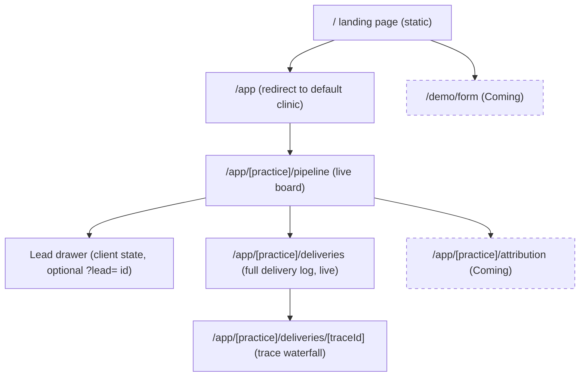

# 5. UI/UX audit and implementation brief

This is the brief for the next (design) agent. It is based on the running app (web :3000, API :4000) driven headless with Playwright + local Chrome on 2026-10-26, and on the code. Read §1 and §8 first. §2–§7 give the reasons and the detail.

**Honesty rule for every screen:** show only what is built, and never fake data. When this audit was written, AI triage, attribution, the triage eval and the fake ad form were not built, so it asked for them to be labelled "Coming". The rule still holds; those four are now built (see the note below).

> **Update, 2026-10-26 (day 2).** Triage, attribution and the form are now built. This audit is kept as written; read its "Coming" items as history.
> - **AI triage** runs after the webhook's 200 (ADR-15). The card shows a triage chip once the model answers. The lead drawer shows the opener and fields when `DONE`, "Waiting for triage" while `PENDING`, and "Triage failed" when `FAILED` (`apps/web/src/components/board/lead-drawer.tsx:146`).
> - **Attribution** at `/app/[practice]/attribution` shows live numbers. The tab has no "Coming" badge (`apps/web/src/components/app/app-tabs.tsx:10`). It is **not** cached: §5's `use cache` suggestion was dropped, because the page changes with every drag and refetches on stream events (ADR-21).
> - **The ad form** at `/demo/form` posts to the API's `POST /demo/leads`, which signs server-side. The web app still holds no secret. This replaces the server-action signing suggested in §3 and §5 (ADR-22).
> - The landing page's "Coming next" section is gone; triage and attribution are listed as built.

## 0. Screenshots

All are outside the repo, in `/private/tmp/claude-501/-Users-priyanshukumar-Documents-projects-dentology/91dc98e2-a37a-4500-a285-ef9cfdbbaaeb/scratchpad/shots/audit/`. The capture script is `/private/tmp/claude-501/-Users-priyanshukumar-Documents-projects-dentology/91dc98e2-a37a-4500-a285-ef9cfdbbaaeb/scratchpad/shots/audit.ts` (run `bun audit.ts` from that `shots` directory).

| Id | File (absolute path) | Shows |
|---|---|---|
| S1 | `/private/tmp/claude-501/-Users-priyanshukumar-Documents-projects-dentology/91dc98e2-a37a-4500-a285-ef9cfdbbaaeb/scratchpad/shots/audit/01-desktop-1440.png` | Board at 1440×900 |
| S2 | `/private/tmp/claude-501/-Users-priyanshukumar-Documents-projects-dentology/91dc98e2-a37a-4500-a285-ef9cfdbbaaeb/scratchpad/shots/audit/02-header.png` | Header crop |
| S3 | `/private/tmp/claude-501/-Users-priyanshukumar-Documents-projects-dentology/91dc98e2-a37a-4500-a285-ef9cfdbbaaeb/scratchpad/shots/audit/03-card.png` | Cards in the New column |
| S4 | `/private/tmp/claude-501/-Users-priyanshukumar-Documents-projects-dentology/91dc98e2-a37a-4500-a285-ef9cfdbbaaeb/scratchpad/shots/audit/04-card-focus.png` | Card with keyboard focus: no visible focus indicator |
| S5 | `/private/tmp/claude-501/-Users-priyanshukumar-Documents-projects-dentology/91dc98e2-a37a-4500-a285-ef9cfdbbaaeb/scratchpad/shots/audit/05-card-enter.png` | Enter on a focused card starts a keyboard drag instead of opening the drawer |
| S6 | `/private/tmp/claude-501/-Users-priyanshukumar-Documents-projects-dentology/91dc98e2-a37a-4500-a285-ef9cfdbbaaeb/scratchpad/shots/audit/06-drawer.png` | Lead drawer ("Reading the enquiry…") |
| S7 | `/private/tmp/claude-501/-Users-priyanshukumar-Documents-projects-dentology/91dc98e2-a37a-4500-a285-ef9cfdbbaaeb/scratchpad/shots/audit/07-new-lead-fresh.png` | A new lead 150 ms after the webhook |
| S8 | `/private/tmp/claude-501/-Users-priyanshukumar-Documents-projects-dentology/91dc98e2-a37a-4500-a285-ef9cfdbbaaeb/scratchpad/shots/audit/08-trace-early.png` | Trace opened 300 ms after the webhook |
| S9 | `/private/tmp/claude-501/-Users-priyanshukumar-Documents-projects-dentology/91dc98e2-a37a-4500-a285-ef9cfdbbaaeb/scratchpad/shots/audit/09-trace.png` | Full trace waterfall |
| S10 | `/private/tmp/claude-501/-Users-priyanshukumar-Documents-projects-dentology/91dc98e2-a37a-4500-a285-ef9cfdbbaaeb/scratchpad/shots/audit/10-attribution-404.png` | The Attribution tab: Next's default 404 |
| S11 | `/private/tmp/claude-501/-Users-priyanshukumar-Documents-projects-dentology/91dc98e2-a37a-4500-a285-ef9cfdbbaaeb/scratchpad/shots/audit/11-unknown-practice.png` | Unknown clinic slug: default 404 |
| S12 | `/private/tmp/claude-501/-Users-priyanshukumar-Documents-projects-dentology/91dc98e2-a37a-4500-a285-ef9cfdbbaaeb/scratchpad/shots/audit/12-sse-blocked.png` | SSE blocked: header still says "Live" |
| S13 | `/private/tmp/claude-501/-Users-priyanshukumar-Documents-projects-dentology/91dc98e2-a37a-4500-a285-ef9cfdbbaaeb/scratchpad/shots/audit/13-laptop-1280.png` | 1280×800 |
| S14 | `/private/tmp/claude-501/-Users-priyanshukumar-Documents-projects-dentology/91dc98e2-a37a-4500-a285-ef9cfdbbaaeb/scratchpad/shots/audit/14-tablet-1024.png` | 1024×768: 2×2 columns, each cut off |
| S15 | `/private/tmp/claude-501/-Users-priyanshukumar-Documents-projects-dentology/91dc98e2-a37a-4500-a285-ef9cfdbbaaeb/scratchpad/shots/audit/15-tablet-768.png` | 768×1024 |
| S16 | `/private/tmp/claude-501/-Users-priyanshukumar-Documents-projects-dentology/91dc98e2-a37a-4500-a285-ef9cfdbbaaeb/scratchpad/shots/audit/16-mobile-390-full.png` | 390×844: one card visible per column, names truncated |
| S17 | `/private/tmp/claude-501/-Users-priyanshukumar-Documents-projects-dentology/91dc98e2-a37a-4500-a285-ef9cfdbbaaeb/scratchpad/shots/audit/17-first-paint.png` | First paint: "0 over 5 minutes" and "–:––" timers before hydration |
| S18 | `/private/tmp/claude-501/-Users-priyanshukumar-Documents-projects-dentology/91dc98e2-a37a-4500-a285-ef9cfdbbaaeb/scratchpad/shots/audit/18-harley.png` | Second clinic (Harley Dental Manchester) |

Measured facts from the run:
- Tab order: Pipeline → Attribution → practice select → cards. Cards report `outline-style: none` and no box-shadow when focused (S4).
- Enter on a focused card: no dialog opens. The dnd-kit live region says "Draggable item cmvp0qz520001bc4hf6us0mol was moved over droppable area NEW." (S5).
- With `prefers-reduced-motion: reduce`, 17 elements still run the `pulse` animation.
- No page scrolls horizontally at 390/768/1024/1280. At ≤ 1024 the page height equals the viewport, and every column is a tiny inner scroller (S14, S16).
- Muted text is `lab(48.5)` (about #737373), 11–12 px. That's ≈ 4.7:1 on white and ≈ 4.4:1 on the `bg-muted/60` columns, which is borderline for small text.
- Console: one 404 (the attribution prefetch). No other errors.

## 1. Top 10 findings, in priority order

| # | P | Finding | Evidence | Fix |
|---|---|---|---|---|
| 1 | P0 | **The UI claims AI is working when it isn't built.** Every card says "AI triage pending". The drawer says "Reading the enquiry…" and "it will be retried" for `FAILED`. No triage code exists. In an interview this is a credibility risk | `apps/web/src/components/board/lead-card.tsx:32-35`, `apps/web/src/components/board/lead-drawer.tsx:77-80`; S1, S6 | Remove the triage line from cards while `PENDING`. In the drawer, show a muted "AI triage: coming soon" panel with one sentence on what it will do. Show real triage only when `triageStatus === "DONE"` |
| 2 | P0 | **Attribution tab is a dead link** (Next's default 404) | `apps/web/src/components/practice-nav.tsx:14`; S10 | Remove the tab, or route it to a "Coming" page that explains the metric (cost per booked consult, value per £1) without numbers |
| 3 | P0 | **Keyboard users can't use the board.** Cards have `outline-none` and no focus ring. Enter/Space starts a drag instead of opening the drawer. Arrow-key drag between columns uses 25 px steps. The live region reads raw cuids. There's no non-drag way to change stage | `lead-card.tsx:52`; `apps/web/src/components/board/board.tsx:98-102`; S4, S5 | Add a `focus-visible` ring. Make Enter open the drawer and give drag its own handle, or a "Move to…" menu. Add a stage `<select>`/segmented control in the drawer that calls the same PATCH. Pass dnd-kit `accessibility.announcements` using lead names and stage labels |
| 4 | P0 | **"Live" indicator is decorative.** It's always green and pulsing, even with the stream blocked. Reconnects and resyncs are invisible | `practice-nav.tsx:36-38`; `apps/web/src/hooks/use-lead-stream.ts:17-30`; S12 | Expose the stream state from `useLeadStream`: `connecting`, `live`, `reconnecting`, `resyncing`, `failed`. Show Live / Reconnecting… / Offline with text, not colour alone |
| 5 | P1 | **Board is unusable below 1280 px.** At 1024 it shows a 2×2 grid of short columns. At 390, one truncated card per column, and `touch-none` on cards blocks scrolling by swiping on a card | `board.tsx:141`, `lead-card.tsx:52`; S14, S16 | ≥ 1280: 4 columns + side log. 768–1279: horizontally scrolling columns (`scroll-snap`, ~300 px each), log in a tab or drawer. < 768: stage tabs with counts, a vertical card list, and "Move to…" instead of drag |
| 6 | P1 | **First paint lies.** The stats bar says "0 over 5 minutes", then jumps to 16 after hydration. Timers show "–:––" | `board.tsx:193-212`, `apps/web/src/hooks/use-now.ts:26-27`; S17 | While `now === null`, render a neutral skeleton for the overdue count, not 0. Keep "–:––" but give it the same width so nothing shifts |
| 7 | P1 | **Trace sheet: the two lanes look the same, and early clicks show a partial trace.** Hub spans use `text-primary`/`bg-primary`, which is near-black in this theme, so the "Coloured: the LISTEN hub" legend is false. The trace is fetched once, and spans are written after the response | `apps/web/src/components/board/trace-sheet.tsx:59`, `:66`, `:80-81`, `:23-35`; S8, S9 | Give the request and hub lanes distinct hues plus a lane label column. Group spans under "API request" / "LISTEN hub". If the trace has no "SSE push"/"no open streams" span yet, refetch after 500 ms and 1500 ms. Show "response sent" as a vertical marker |
| 8 | P1 | **Delivery log hides the "3 deliveries → 1 lead" story.** Retries are separate rows, and because the list is sorted newest-first, "Created" appears *below* its duplicates | `apps/web/src/components/board/delivery-log.tsx:32-52`; S1 | Group consecutive rows by `sourceLeadId`: "Priya Hughes · 3 deliveries → 1 lead" with Created/Duplicate chips. Expand to individual rows, each still opening its trace |
| 9 | P1 | **Reduced motion ignored.** Pulses (Live dot, red timers, skeleton) and slide-in highlights run under `prefers-reduced-motion: reduce` | `practice-nav.tsx:37`, `apps/web/src/components/board/speed-timer.tsx:54`, `board.tsx` fresh classes via `lead-card.tsx:14` | Prefix with `motion-safe:`. Under reduced motion, show a fresh lead with a static ring + "New" badge for 4 s |
| 10 | P1 | **Error, not-found and empty states are framework defaults.** An unknown clinic gets the bare Next 404. API down shows the dev overlay or a blank error. Empty columns are blank. `/` with zero practices redirects to `/404` | `apps/web/src/app/page.tsx:15-16`, `apps/web/src/lib/practice.ts:10`; no `error.tsx`/`not-found.tsx` exists; S11 | Add `not-found.tsx` ("We can't find that clinic" + clinic switcher), `error.tsx` per segment showing `ApiError.requestId` and a Retry, and empty copy per column (see §4) |

Smaller findings are in §2. The full checklist is §8.

## 2. Findings per surface

### Header (`apps/web/src/components/practice-nav.tsx`) — S2

- **Hierarchy.** The logo's "Line" uses `text-primary`, which is near-black, so the two-tone wordmark doesn't show. The clinic name, the one thing a sales person must not get wrong, appears only inside a native `<select>` at the far right.
- **Do:** put the clinic name next to the logo as the page title ("Smile Studio London · Pipeline"). Keep the switcher as a compact control, with a visible label, or an icon + `aria-label` as now. Move the stream status next to the clinic name.
- Nav tabs: active state relies on `bg-secondary` (very light grey) only. Add `aria-current="page"` and a stronger indicator (underline or weight).
- The select uses `router.push` on change (`:43`). Fine, but there's no pending state: the board stays stale until the new practice streams in. Wrap it in `useTransition` and dim the main area while pending.

### Stats bar (`apps/web/src/components/board/board.tsx:193-212`)

- These are the most important numbers on the screen ("16 over 5 minutes"), shown as 14 px body text. Make them three stat chips: **Waiting** (count), **Over 5 min** (red when > 0, with an icon), **Lost** (link to a future Lost list).
- "waiting for first contact" counts only `NEW` without `firstContactedAt` (`:195`). Correct, but say so in a tooltip.
- First paint shows 0 overdue (Finding 6).

### Pipeline board (`board.tsx:136-191`)

- Columns use the same grey, and the column count badges are low contrast (12 px muted on white). Fine for density, but the column **header** is the only stage cue. Add a thin top border colour per stage (neutral → blue → violet → green) that also appears as a dot on cards in the drawer.
- Columns scroll internally (`overflow-y-auto`, `:172`) with no scroll affordance. At 900 px tall, the New column hides most of its 17 cards. Add a fade at the bottom edge and the count "17" in the header (already there).
- The New column should sort **oldest first** (most overdue on top) or by "overdue first". Today all columns sort newest first (`:129`), which puts the freshest, least urgent lead at the top of the work queue. Keep newest-first for the other columns.
- The Lost drop zone appears only during a drag, below the columns (`:177-191`, S5). It is easy to miss at the bottom of a tall board. Make it a fifth slim column or a right-edge target during the drag.
- No way to see or restore Lost leads. "24 lost" is a dead end. Add a Lost view later (P2).
- Rollback after a failed PATCH restores the whole previous array (`:110`, `:116`) and can drop SSE updates received in the meantime. Roll back only the moved card (P2, logic).

### Cards (`apps/web/src/components/board/lead-card.tsx`) — S3

- Three lines: name + timer; triage line; campaign. The triage line is noise today (Finding 1). Use the space for the **treatment** inferred from the campaign (e.g. "Invisalign") and the **source icon** (Meta/Google/TikTok/Website), already available as `campaign.platform` and `source`.
- Names truncate at narrow widths (S16). At ≥ 280 px card width they fit, so fix by layout, not by font size.
- The card is a `<button>` containing a `
`, which is valid, but the whole card is one control for both open and drag (Finding 3).
- `fresh` highlight: `ring-primary/60` (dark grey) for 4 s. Make it a brand accent plus a "New" chip, so it reads in a recording.
- Density is good: about 7 cards per column at 900 px. Keep the padding.

### Speed timer (`apps/web/src/components/board/speed-timer.tsx`)

- Good: frozen time after contact with a ✓, colour plus text, monospace with tabular numbers, one shared ticker.
- Thresholds green < 3 min, amber < 5, red ≥ 5 (`:8-9`). Red never escalates further, so "1h 8m" and "3d 4h" look the same. Add a fourth state ≥ 60 min: solid red background, white text.
- The ✓ frozen state uses green only if contact took < 5 min (`:22`), otherwise grey. Good, but the meaning isn't explained. Add a `title` or tooltip: "Contacted after 7m".
- `title` attributes are the only labels (`:25`, `:47`). Screen readers get "0:22" with no context. Add `aria-label="Waiting 22 seconds for first contact"` or visually hidden text.
- Pulsing red dot: wrap it in `motion-safe:` (Finding 9).

### Lead drawer (`apps/web/src/components/board/lead-drawer.tsx`) — S6

- **Missing the primary action.** The phone number is plain mono text (`:56`). Make it a `tel:` link styled as the primary button ("Call 07700 900446"), with email as `mailto:`. That is the job the drawer exists for.
- **No stage control** (Finding 3). Add "Move to" with the five stages. That's also the touch/mobile path.
- Triage section shows invented progress (Finding 1).
- Timeline is good: first-reach times with +elapsed. Add who and how later.
- Treatment value:
  - Initialised once from the lead (`:129`) and keyed by lead id, so an SSE update from another tab doesn't refresh the input. Sync it while the field isn't dirty.
  - No client-side max. The API rejects > £250,000 with a 400 (`packages/shared/src/index.ts:44`), and the UI shows a generic "Couldn't save". Validate inline: `min=0`, max 250000, error under the field.
  - The success toast formats with `formatGBP`, which drops pence (`apps/web/src/lib/format.ts:38`). Fine for plan values; decide and document.
  - The warning "Accepted with no value: attribution counts it as £0." (`:173-175`) refers to a page that isn't built. Rephrase: "Add the plan value so this lead counts in revenue reports."
- Width `sm:max-w-md`. OK on desktop, full-width on mobile. The header timer and close button crowd at 390 px; give the close button 44×44.

### Delivery log (`apps/web/src/components/board/delivery-log.tsx`)

- The subtitle "Every request, retries included · 14 duplicates caught" counts duplicates in the visible 30 rows only (`:18`), which mislabels it as a total. Say "in the last 30".
- Timestamps: 11 px mono muted. Readable, but the smallest text on the page. Use 12 px.
- Outcome chips: colour + text. Good.
- Group retries (Finding 8).
- Rows with no `traceId` are disabled with no explanation (`:36`). Add a tooltip.
- It belongs on its own route too (see §3). On the pipeline, keep a compact "Last 10" version.

### Trace sheet (`apps/web/src/components/board/trace-sheet.tsx`) — S8, S9

- Strong for the interview: real span names, offsets and durations.
- Lanes are indistinguishable (Finding 7). The legend sentence is the only explanation.
- `error` covers both 404 and network failure: "No trace recorded for this request." (`:52`). Distinguish them: 404 → "Trace not written yet" with auto-retry. Other errors → "Couldn't load the trace" + Retry.
- Point marks (`durationMs: null`) render as 3 px ticks, and "@ 14 ms" vs "1.8 ms" is subtle. Add a column header ("at" / "took") or separate styles.
- Make it deep-linkable (`/app/[practice]/deliveries/[traceId]`) so a trace can be shared.
- Show the delivery outcome as a chip in the header, not lowercase text (`:47`).

### Empty, loading and error states

| Surface | Today | Wanted |
|---|---|---|
| Header loading | Blank 57 px bar (`apps/web/src/app/[practice]/layout.tsx:9`) | Logo + skeleton clinic name (logo is static) |
| Board loading | `BoardSkeleton` with column names and 3 pulse blocks, empty side panel (`apps/web/src/components/board/board-skeleton.tsx`) | Same, plus a skeleton stats bar and delivery rows; `motion-safe` pulse |
| Empty column | Blank grey area | New: "No new leads. They'll appear here the moment a form is submitted." Contacted: "Leads you've called move here." Consult booked / Treatment accepted: "Nothing in the last 7 days." |
| Empty delivery log | "No deliveries yet. Send a lead." (`delivery-log.tsx:28-31`) | Keep, plus the simulator command in a code chip for the demo |
| Unknown clinic | Next default 404 (S11) | "We can't find that clinic" + list of clinics |
| API unreachable on first paint | Error thrown from a server component, no boundary | `error.tsx`: "LeadLine can't reach the server" + Retry + request id |
| Stream lost | Nothing | Header pill "Reconnecting…" (amber), then "Offline" after ~30 s; a banner on resync: "Back online, board refreshed" |

### Cross-cutting

- **Colour.** The theme is shadcn neutral: `--primary` is near-black (`apps/web/src/app/globals.css:58`). Status colours (emerald/amber/red) carry all the meaning. Introduce one brand accent (a calm teal or blue suits a dental and medical context) for primary actions, the fresh highlight, the active tab and the hub lane. Keep red only for overdue and errors.
- **Typography.** Geist Sans + Geist Mono (`apps/web/src/app/layout.tsx:7-8`). Good choice. Raise the floor from 11 to 12 px. Use mono only for times, ids and phone numbers.
- **Contrast.** 12 px muted text on `muted/60` columns is about 4.4:1, below AA (4.5:1). Darken `--muted-foreground` slightly (oklch 0.52) or avoid muted-on-muted.
- **Dark mode.** Tokens exist (`globals.css:86-118`) and `next-themes` is installed, but no provider sets `.dark`. Either wire it up or leave it out. Don't half-ship.
- **Motion.** Keep the 4 s fresh highlight (it is the "lead appears instantly" beat) but respect reduced motion.
- **Copy.** Mostly plain and good ("Drop here to mark as lost", "Couldn't move X. Try again."). Fix the triage copy (Finding 1), the attribution reference in the drawer, and the duplicate-count label.
- **Dev indicator.** Next's "N" badge sits over the bottom-left card in every screenshot (S1). Hide it for recordings: `devIndicators: false` in `apps/web/next.config.ts`.

## 3. Proposed information architecture

| Route | Purpose | Status |
|---|---|---|
| `/` | Landing page: what LeadLine is, for a clinic owner and an interviewer | New |
| `/app` | Redirect to `DEFAULT_PRACTICE` (today's `apps/web/src/app/page.tsx` logic moves here) | Move |
| `/app/[practice]` | Redirect to `/app/[practice]/pipeline` | New |
| `/app/[practice]/pipeline` | The board (today `/[practice]`) | Move |
| `/app/[practice]/deliveries` | Full delivery log with grouping, filters (Created / Duplicate / Rejected) and live updates | New, built from existing data |
| `/app/[practice]/deliveries/[traceId]` | Trace waterfall as a page. The pipeline sheet links here | New, existing endpoint |
| `/app/[practice]/attribution` | Placeholder that explains the metric. No numbers | Coming |
| `/demo/form` | Fake Meta-style lead form | Coming |

Navigation inside `/app/[practice]/*`: logo → `/`; clinic name + switcher; tabs **Pipeline · Deliveries · Attribution (Coming badge)**; stream status pill. The old `/[practice]` route can be deleted. It's a local demo, and the README and simulator output don't link to it.

Implementation note: the `/app/[practice]/layout.tsx` keeps today's pattern (`apps/web/src/app/[practice]/layout.tsx:6-20`): a sync layout, and `params` awaited inside a Suspense child. The SSE subscription should move **up** to a client provider in this layout. Then Pipeline and Deliveries share one `EventSource` and the status pill reads its state. Today the hook lives inside `Board` (`apps/web/src/components/board/board.tsx:84-96`).

**Note for `/demo/form` (coming):** `AGENTS.md`'s map has the form "sign + POST" to the webhook. Signing needs the practice's webhook secret, and the web app must hold no secrets (`AGENTS.md` env rules). Do the signing in a server action that reads a demo-only secret from the web server's env, never in the browser, or add an API endpoint for demo submissions. Decide this with the user before building.

### Landing page `/` content (real features only)

Audience: a non-technical clinic owner first, an interviewer second. One page, about 6 sections.

1. **Hero.** "Every enquiry on screen in under a second. Every minute until the call, counted." Sub: "LeadLine is a live lead board for cosmetic dental clinics. Leads from your Meta and Google ads land once, instantly, and your team can see who's waiting." CTA: "Open the live demo" → `/app/smile-studio-london/pipeline`. Secondary: "How it works".
2. **The problem** (3 short cards): leads go cold in minutes; ad platforms send the same lead more than once; clicks aren't patients.
3. **How it works** (3 steps): the ad form is submitted → LeadLine verifies and stores it once → it appears on every screen with a timer running.
4. **Features (built):**
   - Live pipeline: New → Contacted → Consult booked → Treatment accepted, drag to move.
   - Speed-to-lead timer: green, amber, red at 5 minutes. The team sees "16 over 5 minutes".
   - No duplicates: three deliveries of the same lead make one card. The delivery log shows every attempt.
   - Every request traceable: click a delivery to see each step in milliseconds.
   - Each clinic's data is separate: one agency, many clinics, no crossover.
   - Treatment value recorded in pounds, so revenue can be reported later.
5. **Coming** (clearly labelled, greyed, no numbers): AI triage (what the patient wants, urgency, likely concerns, a suggested opener); Attribution (cost per booked consult and treatment value per £1, by campaign); Try-it ad form. If the next agent is short on time, omit this section rather than mock it.
6. **For the technically curious** (collapsed by default): a 5-box architecture strip (ad platform → signed webhook → Postgres → LISTEN/NOTIFY → SSE → browser) and links to the docs on GitHub.

Copy rules: no invented customer logos, testimonials or metrics. The only numbers allowed are ones the product shows (e.g. "red at 5 minutes").

## 4. Data flow → UI states

### Endpoints (`apps/api/src/routes/*.ts`, `apps/api/src/app.ts`)

All errors are JSON `{ error: string, issues? }`, and every response has an `x-request-id` header (except the hijacked SSE stream). Status codes below were checked against the running API.

| Endpoint | Caller | 2xx | Errors | UI must show |
|---|---|---|---|---|
| `GET /health` (`apps/api/src/app.ts:39`) | none yet | `200 {ok:true}` | network | Optional: drive the "Offline" pill when the stream and health both fail |
| `GET /practices` (`apps/api/src/routes/practices.ts:19`) | server: `/app` redirect, layout switcher | `200 Practice[]` | network/5xx | Empty array → "No clinics set up yet". Error → `error.tsx` with retry and request id |
| `GET /practices/:slug` (`practices.ts:39`) | server: layout (`apps/web/src/lib/practice.ts:6-13`) | `200 Practice` | `404 practice not found`; network/5xx | 404 → `notFound()` → custom clinic-not-found page. Other → error boundary |
| `GET /practices/:slug/board` (`practices.ts:41-44`) | server: pipeline page | `200 {leads, lostCount, deliveries}` | `404`; network/5xx | Loading: skeleton. Empty leads: per-column empty copy. 404: not-found. Error: inline board error + Retry (`router.refresh()`) + request id |
| `GET /practices/:slug/stream` (`practices.ts:46-70`) | browser `EventSource` (`apps/web/src/hooks/use-lead-stream.ts:18`) | `200 text/event-stream`: `ready`, `lead.created`, `lead.updated`, `delivery.logged`, `: ping` | `404` before hijack (EventSource stops for good); network drop (EventSource retries) | connecting → live (after first `ready`) → reconnecting (on `error` with `readyState === CONNECTING`) → resyncing (second `ready`, `router.refresh()` pending) → live. `readyState === CLOSED` → failed: "Live updates stopped. Reload." |
| `PATCH /practices/:slug/leads/:id/stage` (`practices.ts:72-84`) | browser drag / Move-to | `200 LeadCard` | `400 invalid body` (bad stage); `404 practice not found` / `404 lead not found`; network/5xx | Optimistic move. On 404 lead: remove the card + toast "This lead no longer exists". On other errors: roll back that card only + toast with Retry |
| `PUT /practices/:slug/leads/:id/value` (`practices.ts:86-96`) | drawer | `200 LeadCard` | `400 invalid body` (negative, > 250,000, not a number); `404`; network/5xx | Pending: button spinner, input disabled. 400: inline field error. 404: close drawer + toast. Other: toast + keep the typed value |
| `GET /practices/:slug/traces/:traceId` (`practices.ts:98-111`) | browser trace sheet/page | `200 {traceId, delivery, spans}` | `404 trace not found` (no spans yet, or wrong practice); network | Loading skeleton rows. 404 → retry at 0.5 s and 1.5 s, then "No trace recorded". Partial (no hub spans) → refetch once. Error → Retry |
| `POST /webhooks/leads` (`apps/api/src/routes/webhooks.ts:31-79`) | ad platforms, simulator; future `/demo/form` | `200 {leadId, duplicate, traceId}` | `401 invalid signature`; `400 body is not JSON`; `400 invalid payload` + issues; `413` > 1 MiB | (Coming form only) Success: "Sent. Watch it appear on the board" + link to its trace. Duplicate: "Already received". 400: field errors from `issues`. 401: configuration error |

Unauthenticated: there is no 401/403 for the `/practices` routes today. When auth lands, every row above gains `401 → sign-in` and `403 → "You don't have access to this clinic"`.

### Live component states

| Component | Loading | Empty | Error | Live | Reconnecting / resyncing | Optimistic | Failed rollback |
|---|---|---|---|---|---|---|---|
| Stream status pill (new) | "Connecting…" grey | – | "Offline" red + Reload | "Live" green dot (`motion-safe` pulse) | "Reconnecting…" amber; on resync "Updated" for 2 s | – | – |
| Stats bar | Skeleton numbers until `now` is known | "0 waiting" in neutral tone, not red | Hidden with board error | Ticks every second | Values dim (opacity 60%) while resyncing | Updates with the optimistic stage | Reverts with the card |
| Board columns | `BoardSkeleton` | Per-column empty copy (§2) | Inline error panel + Retry | New cards slide in with "New" chip for 4 s | Keep last data visible, dimmed. Banner "Reconnecting, changes may be delayed" after 5 s | Card moves at once with a subtle pending mark (spinner dot) until PATCH resolves | Card returns to its column with a 1 s highlight + toast "Couldn't move X. Try again." (button) |
| Card timer | "–:––" fixed width | – | – | Ticks; colour bands | Keeps ticking (client clock) | Freezes with ✓ immediately when moved out of New | Unfreezes |
| Lead drawer | – (opens from in-memory data) | Missing email/phone: "No phone given" | Lead removed elsewhere: "This lead was moved to Lost" or "deleted", with Close | Fields update from SSE unless the value field is dirty | Banner inside drawer if stream is down | Value shows the new amount while saving | Value reverts + inline error |
| Delivery log | Skeleton rows | "No deliveries yet…" | Error row + Retry | Grouped rows slide in | Dimmed | – | – |
| Trace sheet/page | Skeleton spans | "No trace recorded" | "Couldn't load trace" + Retry | Refetch once if hub spans missing | – | – | – |

## 5. Rendering strategy (Next 16 Cache Components)

References read: `apps/web/node_modules/next/dist/docs/01-app/01-getting-started/08-caching.md`, `.../03-api-reference/04-functions/cacheLife.md`, `cacheTag.md`, `revalidateTag.md`, `updateTag.md`, `.../02-guides/incremental-static-regeneration-cache-components.md`.

Facts from those docs that drive the plan:
- With `cacheComponents: true` (already on, `apps/web/next.config.ts:5`), anything not cached and not behind `<Suspense>` blocks prerendering. `use cache` results become part of the static shell unless their lifetime is short. `revalidate: 0` or `expire` < 5 min makes a "dynamic hole", and `stale` < 30 s is excluded from prerenders (`cacheLife.md` "Prerendering behavior").
- `revalidateTag(tag, "max")` marks the tag stale with stale-while-revalidate. `revalidateTag(tag, { expire: 0 })` expires immediately. It works in route handlers and server actions. `updateTag` works **only** in server actions (read-your-own-writes).
- The default `use cache` store is **per instance, in memory**. A `revalidateTag` on one web instance doesn't clear another instance's memory unless you configure a shared cache handler (`use cache: remote` / `cacheHandlers`).
- Arguments become part of the cache key, so pass `slug` into a cached function rather than reading `params` inside it.

| Route / part | Strategy | Why |
|---|---|---|
| `/` landing: all copy, feature sections, architecture strip | **Static shell.** Plain components, no data | Nothing changes per request |
| `/` optional "live stats" (e.g. leads received today) | **Don't add.** If ever wanted: a small client island fed by the existing SSE stream, or `use cache` + `cacheLife("minutes")` | A webhook-triggered `revalidateTag` here would fire on every lead to refresh a vanity number. Not worth a secret-protected endpoint and an API → web dependency |
| `/app` redirect | Dynamic (Suspense child that reads the practice list, as today `apps/web/src/app/page.tsx:5-18`) | Must reflect current practices |
| `/app/[practice]/*` layout frame: logo, tabs, status pill placeholder | **Static shell** | No data |
| Clinic name + switcher list | **`use cache` + `cacheTag("practices")` + `cacheLife("days")`**, with `slug` passed as an argument | Practices change rarely. Removes 2 API calls per navigation. If a clinic is added, it shows within the profile's revalidate window, or call `revalidateTag("practices", "max")` from an admin action later. A `notFound()` for unknown slugs must stay outside the cached function (cache the list, decide 404 in the uncached child) |
| `/app/[practice]/pipeline` board data | **Dynamic, never cached.** Suspense child with `cache: "no-store"` (as today), then SSE | Changes by the second and is pushed live. Any cache layer would only introduce staleness that the resync logic then fights |
| `/app/[practice]/deliveries` | **Dynamic** first page + SSE | Same as the board |
| `/app/[practice]/deliveries/[traceId]` | **Dynamic.** Client fetch with retry, or a dynamic server component | A trace is write-once, but it's written in stages after the response. Caching an early partial trace with a long lifetime would freeze it incomplete. Caching only "complete" traces needs a completeness rule. Not worth it for a debugging view |
| `/app/[practice]/attribution` (coming) | **Candidate for `use cache`** + `cacheTag(\`attribution:${slug}\`)` + `cacheLife("minutes")` | Aggregates over all leads. Changes only on stage moves to booked/accepted, value edits and spend edits. Start with time-based `minutes`, since the query is cheap at clinic scale |
| On-demand revalidation for attribution | **Only if needed later.** The API would `POST` to a secret-protected Next route handler (`/api/revalidate`, header `x-revalidate-secret`) that runs `revalidateTag(\`attribution:${slug}\`, "max")`. Trigger only on `CONSULT_BOOKED`/`TREATMENT_ACCEPTED` transitions and value or spend changes, debounced | Justified only if (a) the attribution query becomes expensive, **and** (b) the web tier is a single instance or uses a shared cache handler. Otherwise one instance revalidates and the others keep serving their own memory. It also adds a secret to the web tier, a second failure path (web down → revalidation silently lost, so keep a time-based `cacheLife` as backstop) and coupling from API to web. For a live demo with one web process, `cacheLife("minutes")` alone is the honest answer |
| `updateTag` | **Not applicable today** | All writes go browser → API directly (ADR-08), with no server actions. If the value edit moved to a server action, `updateTag(\`attribution:${slug}\`)` would give read-your-own-writes on the attribution page |
| `/demo/form` (coming) | Static shell. Submission via server action (signs server-side) | No data on render |
| `generateStaticParams` for `[practice]` | **No** | It would make the build depend on the API being up. The docs warn that build-time data sources must also be available at request time. Little gain, since the frame is already static |

Summary: **static** = landing + app frame. **Cached** = practice list/name (days) and, later, attribution (minutes). **Dynamic** = board, deliveries, traces. **On-demand webhook revalidation** isn't worth it today for any page. Revisit only for attribution under the two conditions above.

## 6. Accessibility checklist (WCAG 2.2 AA targets)

- Focus visible on every interactive element, cards included (2.4.7, 2.4.11). Today it fails on cards (S4).
- All functionality available by keyboard without drag (2.1.1, 2.5.7 "Dragging Movements"): drawer "Move to" control + per-card menu.
- dnd-kit announcements in words: "Picked up Lucy Clarke from New", "Moved over Consult booked", "Dropped Lucy Clarke in Consult booked".
- Status not by colour alone (1.4.1): the timer has text, outcome chips have text, the Live pill needs text (Finding 4).
- Contrast ≥ 4.5:1 for 12 px text (1.4.3): fix muted-on-muted.
- Reduced motion (2.3.3): `motion-safe:` on every pulse and slide.
- Live updates: one polite `aria-live` region announcing "New lead: Lucy Clarke, Veneers" (throttled), not every SSE event.
- Target size ≥ 24×24 (2.5.8): drawer close, delivery rows OK, column count badges are not interactive.
- `lang="en-GB"` already set (`apps/web/src/app/layout.tsx:17`).

## 7. Things the design agent must not break

- The Suspense pattern: no API reads at the top of a page or layout (ADR-11, `AGENTS.md`).
- `DndContext id={useId()}` (hydration, `apps/web/src/components/board/board.tsx:51-52`).
- Times in Europe/London via `apps/web/src/lib/format.ts`. Never `toLocaleString()` without the zone.
- `useNow` server snapshot `null`, so server HTML never bakes in a time (`apps/web/src/hooks/use-now.ts:26-27`).
- The adopt-new-props-during-render resync (`board.tsx:63-70`) if `Board` is refactored.
- The browser talks to the API directly. Don't add a Next proxy for SSE (ADR-08).
- `apps/web/AGENTS.md`: read `apps/web/node_modules/next/dist/docs/` before writing Next code.

## 8. Prioritised implementation checklist

### P0 (before any recording)
- [ ] Remove the "AI triage pending" card line. Replace the drawer's triage section with a labelled "AI triage: coming" panel. Real fields render only when `triageStatus === "DONE"` (`lead-card.tsx:23-36`, `lead-drawer.tsx:73-101`).
- [ ] Remove the Attribution tab or point it at a "Coming" page with no numbers (`practice-nav.tsx:12-15`).
- [ ] Visible `focus-visible` ring on cards. Enter opens the drawer. Add a "Move to" stage control in the drawer calling `browserApi.moveLead`. dnd-kit announcements with names and stage labels.
- [ ] Real stream status: lift `useLeadStream` into a layout-level provider exposing `connecting | live | reconnecting | resyncing | failed`, and render the pill from it.
- [ ] Hide the Next dev indicator for recordings (`devIndicators: false`).

### P1 (the redesign)
- [ ] New routes: `/` landing, `/app`, `/app/[practice]/pipeline`, `/app/[practice]/deliveries`, `/app/[practice]/deliveries/[traceId]`, and an `/app/[practice]/attribution` placeholder (coming). Delete `/[practice]`.
- [ ] Landing page per §3, real features only. The "Coming" section is optional and labelled.
- [ ] Brand accent colour. Stage colour cue. Stat chips for Waiting / Over 5 min / Lost.
- [ ] Responsive board: horizontal scroll-snap columns at 768–1279, stage tabs + list + "Move to" below 768. Remove `touch-none` on mobile layouts.
- [ ] First-paint stats: skeleton instead of "0 over 5 minutes".
- [ ] Delivery log grouping by `sourceLeadId`, "in the last 30" label, 12 px timestamps.
- [ ] Trace view: distinct lane colours + lane labels, auto-refetch for partial/404, distinct error vs not-found, deep link.
- [ ] `motion-safe:` on all pulses and slide-ins. Static "New" chip under reduced motion.
- [ ] `not-found.tsx` (unknown clinic), `error.tsx` (API unreachable, with request id + Retry), per-column empty copy.
- [ ] Drawer: `tel:`/`mailto:` primary actions; inline value validation (0–250,000); sync value from SSE when not dirty; reword the "attribution counts it as £0" note.
- [ ] New column sorted oldest-first (most overdue on top).
- [ ] Practice name/list via `use cache` + `cacheTag("practices")` + `cacheLife("days")`, with `notFound()` decided outside the cached function.

### P2 (polish and later)
- [ ] Fourth timer band ≥ 60 min. Tooltip/aria-label text on timers.
- [ ] Lost leads view with restore.
- [ ] Per-card rollback instead of whole-array rollback (`board.tsx:110-121`).
- [ ] Contrast: darken `--muted-foreground` or avoid muted-on-muted.
- [ ] Dark mode: wire `next-themes` or remove the unused tokens.
- [ ] Polite `aria-live` announcement for new leads.
- [ ] Attribution page (when built): `use cache` + `cacheLife("minutes")`. Consider webhook-triggered `revalidateTag` only under the conditions in §5.
