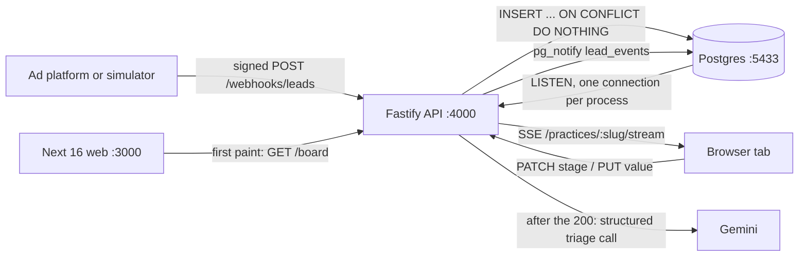

# LeadLine docs

LeadLine is a live lead board for cosmetic dental clinics. Ad platforms (Meta Lead Ads, Google lead forms) post each enquiry to a signed webhook. LeadLine stores it once even when the platform retries, and pushes it to every open browser tab within milliseconds. A speed-to-lead timer then shows how long the patient has waited for a call. The sales team drags each lead from New to Contacted, Consult booked and Treatment accepted, and records the treatment plan value. Every webhook request is logged and can be traced step by step. One API serves many clinics, and each query is scoped to one clinic. It is a two-day demo for a Dentology job application: a Fastify API, a Next 16 UI and Postgres, running locally.

**Status.** Everything described here is built: webhook ingestion, idempotency, the delivery log, the live board over SSE, drag-and-drop stages, the speed timer, the lead drawer with treatment value, tenant scoping, request tracing, AI triage with Gemini (after the 200, plus `bun run triage:sweep`), the 20-item triage eval (`bun run triage:eval`), the attribution page and the try-it ad form at `/demo/form`. Day 2 (2026-10-26) added the last four.

## Read in this order

| # | File | What it gives you |
|---|---|---|
| 1 | [01-problem.md](01-problem.md) | The business problem: who uses it, lead leakage, speed-to-lead, retries, attribution, multi-clinic data, and which feature answers which problem |
| 2 | [02-architecture.md](02-architecture.md) | Services, the 5-table ERD, one webhook from POST to card-on-screen, triage after the 200, attribution, a drag, the stage state machine, tenancy, the connection budget, UML class and deployment diagrams |
| 3 | [03-decisions.md](03-decisions.md) | Every design decision as an ADR, with trade-offs, failure modes and likely interview questions |
| 4 | [04-integrations.md](04-integrations.md) | What real Meta and Google webhooks need, what's implemented and what production still needs, with sources |
| 5 | [05-ui-ux-audit.md](05-ui-ux-audit.md) | The UI audit with screenshots, the proposed route structure, the UI state for each endpoint, the rendering strategy and a P0/P1/P2 checklist |
| – | [testing.md](testing.md) | How the system is tested: 104 Vitest tests mapped to decisions, the Postman collection, coverage |

## Ten-second map

## Conventions in these docs

- Every claim about code cites `path:line` from the repo root.
- "Planned" means the code does not exist yet. Nothing planned is described as working. As of day 2 no product feature is planned; the word is left only on production work (real Meta/Google adapters, auth).
- Diagrams are mermaid. They render on GitHub and were checked with `mmdc`.
- Source of truth for decisions: `AGENTS.md`. These docs explain those decisions. Where the docs and the code disagree, the code wins, and `03-decisions.md` lists the drift.
